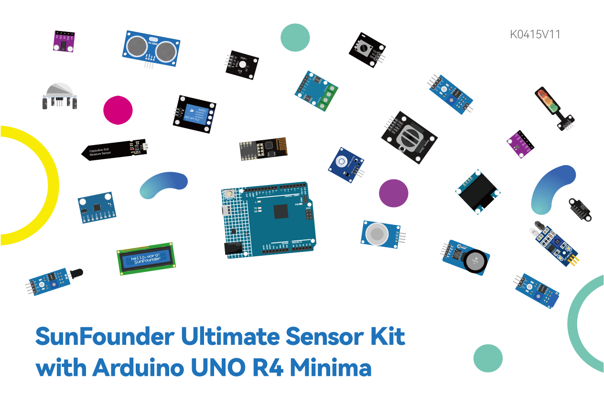

.. note::

    Hello, welcome to the SunFounder Raspberry Pi & Arduino & ESP32 Enthusiasts Community on Facebook! Dive deeper into Raspberry Pi, Arduino, and ESP32 with fellow enthusiasts.

    **Why Join?**

    - **Expert Support**: Solve post-sale issues and technical challenges with help from our community and team.
    - **Learn & Share**: Exchange tips and tutorials to enhance your skills.
    - **Exclusive Previews**: Get early access to new product announcements and sneak peeks.
    - **Special Discounts**: Enjoy exclusive discounts on our newest products.
    - **Festive Promotions and Giveaways**: Take part in giveaways and holiday promotions.

    👉 Ready to explore and create with us? Click [|link_sf_facebook|] and join today!

SunFounder |link_Ultimate_Kit|
==================================================

* |link_Ultimate_Sensor_Kit|

Thanks for choosing our |link_Ultimate_Kit|.

.. note::
    This document is available in the following languages.

        * |link_german_tutorials|
        * |link_jp_tutorials|
        * |link_en_tutorials|
    
    Please click on the respective links to access the document in your preferred language.

The **Ultimate Sensor Kit** is built around the Arduino Uno R4 Minima and comes with
more than 30 modules - ultrasonic, flame, accelerometer and gyroscope, pulse oximeter,
and many more. Every module is paired with a beginner-friendly example, so you get the
parts and the know-how.

Work through the course step by step and you will go from blinking an LED to real
projects: IoT projects that report to **Blynk** over Wi-Fi, Bluetooth projects controlled
from your phone, and fun builds such as a smart trash can or an automatic soap dispenser.

If you have any questions or other interesting ideas, feel free to send an email to
service@sunfounder.com.

**Table of contents**

.. toctree:: 
    :maxdepth: 2

    About Ultimate Sensor Kit <self>
    arduino_start/00_get_start
    arduino_video_course/arduino_video_course
    download_code
    components_basic/00-component_list
    iot_project
    fun_project/fun_project
    faq/00_faq
    thank-learning
 
**Copyright Notice**

All contents including but not limited to texts, images, and code in this manual are owned by the SunFounder Company. You should only use it for personal study, investigation, enjoyment, or other non-commercial or nonprofit purposes, under the related regulations and copyrights laws, without infringing the legal rights of the author and relevant right holders. For any individual or organization that uses these for commercial profit without permission, the Company reserves the right to take legal action.
