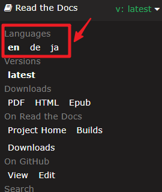

.. note::

    Hallo und willkommen in der SunFounder Raspberry Pi & Arduino & ESP32 Enthusiasten-Gemeinschaft auf Facebook! Tauchen Sie tiefer ein in die Welt von Raspberry Pi, Arduino und ESP32 mit anderen Enthusiasten.

    **Warum beitreten?**

    - **Expertenunterst眉tzung**: L枚sen Sie Nachverkaufsprobleme und technische Herausforderungen mit Hilfe unserer Gemeinschaft und unseres Teams.
    - **Lernen & Teilen**: Tauschen Sie Tipps und Anleitungen aus, um Ihre F盲higkeiten zu verbessern.
    - **Exklusive Vorschauen**: Erhalten Sie fr眉hzeitigen Zugang zu neuen Produktank眉ndigungen und exklusiven Einblicken.
    - **Spezialrabatte**: Genie脽en Sie exklusive Rabatte auf unsere neuesten Produkte.
    - **Festliche Aktionen und Gewinnspiele**: Nehmen Sie an Gewinnspielen und Feiertagsaktionen teil.

    馃憠 Sind Sie bereit, mit uns zu erkunden und zu erschaffen? Klicken Sie auf [|link_sf_facebook|] und treten Sie heute bei!

SunFounder |link_Ultimate_Kit|
==================================================

* |link_Ultimate_Sensor_Kit|

Danke, dass Sie sich f眉r unser |link_Ultimate_Kit| entschieden haben.

.. note::
    Dieses Dokument ist in den folgenden Sprachen verf眉gbar.

        * |link_german_tutorials|
        * |link_jp_tutorials|
        * |link_en_tutorials|
    
    Bitte klicken Sie auf die jeweiligen Links, um das Dokument in Ihrer bevorzugten Sprache aufzurufen.

.. image:: img/ultimate-sensor-kit-cover.png
    :width: 800

Entt盲uscht von einem Online-Lernkit, das nur mit einer rudiment盲ren Anleitung geliefert wurde? Schon immer den Wunsch gehabt, in die Welt der Elektronik einzutauchen, aber von der Komplexit盲t abgeschreckt?

Fasziniert von genialen Elektronikprojekten, die von Enthusiasten vorgef眉hrt werden, und sich gefragt, wie sie angefangen haben?

Wir pr盲sentieren: Das Ultimate Sensor Kit mit Arduino Uno R4 Minima. Die L枚sung f眉r all Ihre kreativen Herausforderungen in einem kompakten Paket.

Angetrieben vom revolution盲ren Arduino R4 leitet dieses Kit eine neue 脛ra f眉r Open-Source-Begeisterte ein. Mit einem leistungsstarken 32-Bit-Prozessor, reichlich Speicher und mehr ist es darauf ausgelegt, sich nahtlos in neue wie bestehende Projekte einzuf眉gen.

Es enth盲lt nicht nur 眉ber 30 hochmoderne Module wie den Ultraschallsensor, Flammensensor, Beschleunigungsmesser & Gyroskop und sogar den Pulsoximeter und Herzfrequenzsensor, sondern jede Komponente wird mit einem anf盲ngerfreundlichen Code-Beispiel gepaart. So besitzen Sie nicht nur die Werkzeuge, sondern auch das n枚tige Grundwissen.

Tauchen Sie tief in die Welt des IoT ein mit ma脽geschneiderten Projekten, die den Arduino mit Plattformen wie Blynk 眉ber das ESP8266 WiFi-Modul verbinden. Entfesseln Sie Ihre Innovationskraft durch die Gestaltung von Projekten wie dem Flammenwarnsystem, dem Einbruchswarnsystem und sogar einem Bluetooth-gesteuerten Umweltmonitor.

Aber das ist noch nicht alles; st眉rzen Sie sich in eine Vielzahl spannender Projekte! Bauen Sie einen intelligenten M眉lleimer, entwickeln Sie einen automatischen Seifenspender oder vielleicht ein bewegungsgesteuertes Relais. Das Kit erweitert Ihren Horizont und erm枚glicht es Ihnen, Ihre Vorstellungskraft in greifbare Kreationen umzusetzen.

Hier geht es nicht nur darum, Schritte zu befolgen; es geht um Verst盲ndnis, Experimentieren und Erfinden. Anstatt lediglich zu replizieren, werden Sie Projekte gestalten, die einzigartig Ihr Eigen sind.

Warum nur Zuschauer sein, wenn Sie auch Sch枚pfer sein k枚nnen? Beginnen Sie Ihre Reise in die fesselnde Welt der Elektronik mit dem Ultimate Sensor Kit. Ihr Abenteuer beginnt hier!

Bei Fragen oder weiteren interessanten Ideen k枚nnen Sie gerne eine E-Mail an service@sunfounder.com senden.

* :ref:`脺ber die Anzeigesprache`
* :ref:`Inhaltsverzeichnis`
* :ref:`Urheberrechtshinweis`

脺ber die Anzeigesprache
--------------------------------

.. note::

    Neben Englisch arbeiten wir an weiteren Sprachen f眉r diesen Kurs.
    Wenn Sie Interesse an einer Mitarbeit haben, kontaktieren Sie bitte service@sunfounder.com,
    und wir werden Ihnen als Gegenleistung ein kostenloses Produkt zukommen lassen.

Aktuell werden im Online-Tutorial die Sprachen Englisch, Deutsch und Japanisch unterst眉tzt. Um die Anzeigesprache zu 盲ndern, klicken Sie bitte auf das Symbol **Read the Docs** in der unteren linken Ecke der Seite.

.. raw:: html

     

Inhaltsverzeichnis
--------------------------------

.. toctree::
    :maxdepth: 2

    脺ber das Ultimate Sensor Kit <self>
    arduino_start/00_get_start
    arduino_video_course/arduino_video_course
    download_code
    components_basic/00-component_list
    iot_project
    fun_project/fun_project
    faq/00_faq
    thank-learning

Urheberrechtshinweis
-----------------------

S盲mtliche Inhalte dieses Handbuchs, einschlie脽lich aber nicht beschr盲nkt auf Texte, Bilder und Code, sind Eigentum der SunFounder Company. Sie d眉rfen diese nur f眉r pers枚nliches Studium, Forschung, Vergn眉gen oder andere nichtkommerzielle oder gemeinn眉tzige Zwecke verwenden, gem盲脽 den entsprechenden Vorschriften und Urheberrechtsgesetzen, ohne die rechtlichen Rechte des Autors und der relevanten Rechteinhaber zu verletzen. F眉r jede Einzelperson oder Organisation, die diese Inhalte ohne Genehmigung f眉r kommerzielle Zwecke nutzt, beh盲lt sich das Unternehmen das Recht vor, rechtliche Schritte einzuleiten.
