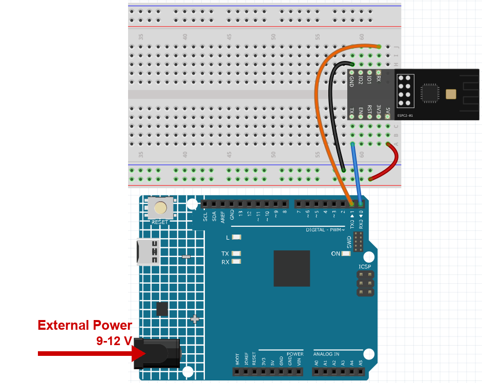

.. note::

    こんにちは、SunFounderのRaspberry Pi & Arduino & ESP32愛好家コミュニティへようこそ！Facebook上でRaspberry Pi、Arduino、ESP32についてもっと深く掘り下げ、他の愛好家と交流しましょう。

    **参加する理由は？**

    - **エキスパートサポート**：コミュニティやチームの助けを借りて、販売後の問題や技術的な課題を解決します。
    - **学び＆共有**：ヒントやチュートリアルを交換してスキルを向上させましょう。
    - **独占的なプレビュー**：新製品の発表や先行プレビューに早期アクセスしましょう。
    - **特別割引**：最新製品の独占割引をお楽しみください。
    - **祭りのプロモーションとギフト**：ギフトや祝日のプロモーションに参加しましょう。

    👉 私たちと一緒に探索し、創造する準備はできていますか？[|link_sf_facebook|]をクリックして今すぐ参加しましょう！

.. _c201_iot_Bluetooth_start:

Bluetooth をはじめる
=============================

ESPC2-01 は **Wi-Fi と Bluetooth を 1 つのモジュールに** 備えているので、このキット
に 2 つ目の Bluetooth チップは要りません。Bluetooth のプロジェクトも、すでにお持ちの
モジュールをそのまま使います。

Wi-Fi のプロジェクトでは、ボードはクラウド経由で Blynk と話していました。ここでは
スマートフォンがモジュールと **直接** 話します。ルーターも、インターネットも、アカ
ウントも不要です。だから Bluetooth はリモコンや小さな表示器に向いています。

この章を終えると、次のことができるようになります。

* モジュールが **SunFounder-C2** としてアドバタイズする
* スマートフォンで入力したテキストがボードに届く
* ボードで入力したテキストがスマートフォンに表示される

1. モジュールを接続する
-----------------------

Wi-Fi のプロジェクトと同じように、モジュールを R4 Minima に配線します。
**5V、GND、TX、RX** の 4 本だけで、他はありません。

.. note::

   モジュールは起動時に大きな電流を引きます。9V 電池または外部電源を R4 Minima
   の DC ジャックに必ず接続してください。

2. スケッチを書き込む
---------------------

#. ``00-Bluetooth_start.ino`` を ``ultimate-sensor-kit\code\iot_project_espc201\bluetooth\00-Bluetooth_start`` から開きます。

#. **Arduino UNO R4 Minima** と正しいポートを選び、**Upload** をクリックします。

   このスケッチは 3 つのことをします。

   * ``SunFounder_BLE.h`` をインクルードします。モジュールの Bluetooth コマンドを包
     む小さなラッパーで、だから残りのコードは ``bleSerial.print()`` と
     ``bleSerial.read()`` だけで済みます。
   * 起動時にラッパーが Bluetooth を有効にし、名前を **SunFounder-C2** に設定して
     アドバタイズを始めるので、スマートフォンから見つけられます。
   * その後は、テキストを双方向に流すだけです。

   .. image:: ../img/ble_start_code.png
      :width: 80%

#. シリアルモニターを **115200** で開きます。次のように表示されます。

   .. code-block:: text

      === ESPC2-01 Bluetooth (BLE) ===
      [OK] BLE is ready - scan for "SunFounder-C2" on your phone
      --------------------------------
      Type here and press Enter: the text is sent to the phone (C305)

   .. image:: ../img/ble_start_serial.png
      :width: 80%

   ``[!] no reply from the module`` と出た場合、モジュールが D0/D1 で応答していませ
   ん。4 本の配線と電源を確認し、ボードのリセットボタンを押してください。

3. スマートフォンでモジュールを見つける
---------------------------------------

#. スマートフォンに **LightBlue** をインストールします。iOS でも Android でも無料で
   す。どの Bluetooth スキャナーでも動きますが、以下の画面は LightBlue のものです。

   .. image:: ../img/ble_lightblue_app.png
      :width: 20%

#. LightBlue を開き **Scan** をタップします。モジュールが **SunFounder-C2** として
   現れます。

   .. note::

      この名前はスケッチから来ています。スケッチで変えれば、スマートフォンには新しい
      名前が表示されます。同じ部屋に複数のキットがあるときに便利です。

   .. warning::

      **スマートフォンの Bluetooth 設定でモジュールをペアリングしないでください。**
      これは BLE なので、ペアリングするものはありません。LightBlue が自分で接続を張り
      ます。*設定 > Bluetooth* で **SunFounder-C2** をタップすると、Android や iOS は
      古い方式のペアリングを始めて PIN を求めますが、モジュールに渡せる PIN はないの
      で、入力が合うことはありません。

      すでに試した場合は、*設定 > Bluetooth* で **デバイスを削除**（またはペアリング
      解除）し、Bluetooth をオフ／オンしてから、LightBlue で接続してください。

   .. image:: ../img/ble_lightblue_scan.png
      :width: 80%

#. **SunFounder-C2** をタップして接続します。サービス一覧が開きます。

#. サービス **0xA002** を展開します。Characteristic **C300** から **C307** が入って
   います。この章で使う 3 つは次のとおりです。

   .. list-table::
      :header-rows: 1
      :widths: 17 26 57

      * - Characteristic
        - 向き
        - 用途
      * - **C304**
        - スマートフォン -> ボード
        - スマートフォンがここにテキストを書き、ボードが読む
      * - **C305**
        - ボード -> スマートフォン
        - ボードがここにテキストを送る。スマートフォンは先に **Subscribe** が必要
      * - **C300**
        - ボード -> スマートフォン
        - 保存された 1 つの値。スマートフォンはいつでも **Read** できる

   .. image:: ../img/ble_lightblue_expand.png
      :width: 80%

4. スマートフォンからボードへテキストを送る
-------------------------------------------

#. **0xC304** を開き **Write new value** をタップします。

   .. image:: ../img/ble_lightblue_write.png
      :width: 80%

#. 右上のボタンで形式を **UTF-8 String** に変え、単語を入力します（例:
   ``hello``）。

   .. note::

      この手順は忘れやすいところです。既定の 16 進形式のままだと、ボードは ``hello``
      という単語ではなく ``68 65 6C 6C 6F`` という数値を受け取ります。

   .. image:: ../img/ble_lightblue_hello.png
      :width: 80%

#. シリアルモニターを見てください。入力したテキストが表示され、ボードはそれをそのま
   ま返すので、双方向に通じていることが分かります。

   .. image:: ../img/ble_lightblue_serial.png
      :width: 80%

5. ボードからスマートフォンへテキストを送る
-------------------------------------------

#. **0xC305** を開き **Subscribe** をタップします。

   **Subscribe** は「これを開いたまま、届くものをすべて表示する」という意味です。こ
   れがないと、スマートフォンはボードが送ったものを黙って捨てます。

   .. image:: ../img/ble_lightblue_subs.png
      :width: 80%

#. シリアルモニターで単語を入力し **Enter** を押します。スケッチが C305 に転送する
   ので、LightBlue に表示されます。

   .. image:: ../img/ble_ide_send.png
      :width: 80%

#. LightBlue にテキストではなく 16 進数が見える場合は、右上の形式を **UTF-8 String**
   にしてください（手順 4 と同じ設定です）。

   .. image:: ../img/ble_ide_receive.png
      :width: 80%

6. ここまでで学んだこと
------------------------

* **Write**（C304） - スマートフォンがボードにデータを送る。
* **Subscribe**（C305） - ボードがスマートフォンにデータを送り、スマートフォンが受
  け取る。
* **Read**（C300） - スマートフォンが好きなときに値を問い合わせる。

次の章もこの 3 つを使うだけで、変わるのはテキストとハードウェアだけです。入力した
文字を表示する LCD、開く鍵、色が変わる RGB ランプなどです。
