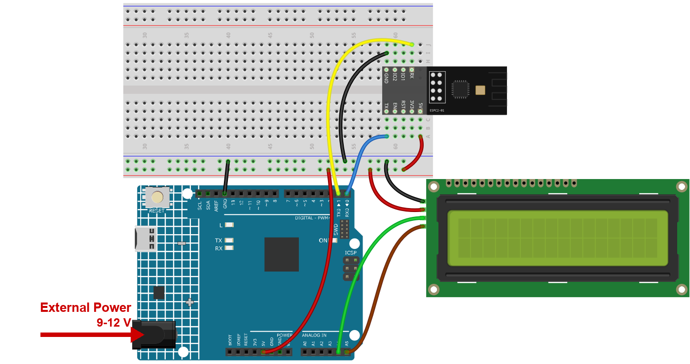

.. note::

    Hello, welcome to the SunFounder Raspberry Pi & Arduino & ESP32 Enthusiasts Community on Facebook! Dive deeper into Raspberry Pi, Arduino, and ESP32 with fellow enthusiasts.

    **Why Join?**

    - **Expert Support**: Solve real-life coding problems and technical challenges with our community and team.
    - **Learn & Share**: Exchange tips, tutorials, and projects to enhance your skills.
    - **Exclusive Previews**: Get early access to new product announcements and sneak peeks.
    - **Festive Promotions and Giveaways**: Take part in giveaways and holiday promotions.

    👉 Ready to explore and create with us? Click [|link_sf_facebook|] and join today!

.. _c201_iot_Bluetooth_lcd:

8. Bluetooth LCD
================

.. .. raw:: html

..    <video loop autoplay muted style = "max-width:100%">
..       <source src="../../_static/video/iot/15-iot_Bluetooth_lcd.mp4"  type="video/mp4">
..       Your browser does not support the video tag.
..    </video>

Type a word on the phone and it appears on the LCD - no cable, no Wi-Fi, no internet.

The board is the same **SunFounder-C2** module from the previous chapter, used the same
way: the phone writes text to characteristic **C304** and the sketch reads it.

1. Build the Circuit
-----------------------------

.. note::

    The module draws a high current at start-up, so make sure the 9 V battery or an external power supply is plugged into the DC jack of the R4 Minima.

* :ref:`cpn_uno`
* :ref:`cpn_espc201`
* :ref:`cpn_i2c_lcd1602`

2. Upload the Code
-----------------------------

#. Open the ``08-Bluetooth_lcd.ino`` file under the path of ``ultimate-sensor-kit\code\iot_project_espc201\bluetooth\08-Bluetooth_lcd``, or copy this code into **Arduino IDE**.

   .. note::

      The sketch needs the **LiquidCrystal I2C** library. Open the Library Manager,
      search for ``LiquidCrystal I2C`` and install it.

#. Select **Arduino UNO R4 Minima** and the right port, then click **Upload**.

#. Open the Serial Monitor at **115200**. You should read:

   .. code-block:: text

      === ESPC2-01 Bluetooth (BLE) ===
      [OK] BLE is ready - scan for "SunFounder-C2" on your phone
      --------------------------------

   If you read ``[!] no reply from the module``, the module is not answering on D0/D1 -
   check the four wires and the power supply.

3. Send Text with LightBlue
------------------------------

Use the same **LightBlue** app as in the Get Started chapter.

#. Open LightBlue, tap **Scan** and connect to **SunFounder-C2**.

#. Expand the service **0xA002** and open the characteristic **C304**. Then tap **Write new value**.

   .. image:: ../img/ble_lightblue_write.png
      :width: 80%

#. Set the format in the top right corner to **UTF-8 String** and type a short word - for example ``hello``. The picture shows the field just before
   sending:

   .. image:: ../img/ble_lightblue_hello.png
      :width: 80%

#. Send it. The word appears on the **LCD** and in the Serial Monitor.

   .. note::

      Keep the text short: the LCD has 16 columns and 2 rows, and everything after the
      first 16 characters moves to the second row. A longer word is simply cut off.

#. To send text the other way - from the board to the phone - subscribe to **C305** and
   then type in the Serial Monitor. This is the same pair of characteristics you used in
   the Get Started chapter, only one side now drives an LCD.

4. Code explanation
-----------------------------

#. **The LCD on the I2C bus**

   .. code-block:: arduino

      #include <LiquidCrystal_I2C.h>
      LiquidCrystal_I2C lcd(0x27, 16, 2);

   ``0x27`` is the I2C address of the display, ``16`` is the number of columns and ``2``
   the number of rows. Most of these modules answer on ``0x27``; a few use ``0x3F``.

#. **Bluetooth in one line**

   .. code-block:: arduino

      #include "SunFounder_BLE.h"
      BLEStream bleSerial;

   ``BLEStream`` hides all the AT commands. ``bleSerial.begin()`` switches Bluetooth on,
   sets the name **SunFounder-C2** and starts advertising; after that the object behaves
   like an ordinary serial port - ``available()``, ``read()``, ``write()``.

   .. note::

      The module talks to the board over D0/D1 (``Serial1``) at **115200**. That is a
      hardware port, so no bit is lost even while the LCD is being updated.

#. **setup()**

   .. code-block:: arduino

      void setup() {
        lcd.init();
        lcd.clear();
        lcd.backlight();

        Serial.begin(115200);
        bleSerial.begin();
        bleSerial.setTimeout(50);
      }

   ``lcd.backlight()`` matters: without it the display works but stays dark. The short
   ``setTimeout(50)`` stops ``readString()`` from waiting a full second for more
   characters that will never come.

#. **loop() - phone to LCD**

   .. code-block:: arduino

      if (bleSerial.available()) {
        data += bleSerial.readString();
        while (data.endsWith("\r") || data.endsWith("\n")) {
          data.remove(data.length() - 1);
        }
        lcd.clear();
        lcd.setCursor(0, 0);
        lcd.print(data);
      }

   The phone often adds a line ending to what you type. Only those characters are removed
   - never a real character - and then the text is written to the display.

#. **loop() - board to phone**

   .. code-block:: arduino

      if (Serial.available()) {
        bleSerial.write(Serial.read());
      }

   Anything you type in the Serial Monitor is forwarded to **C305**. Subscribe to it in
   LightBlue and the characters appear there, byte by byte.

