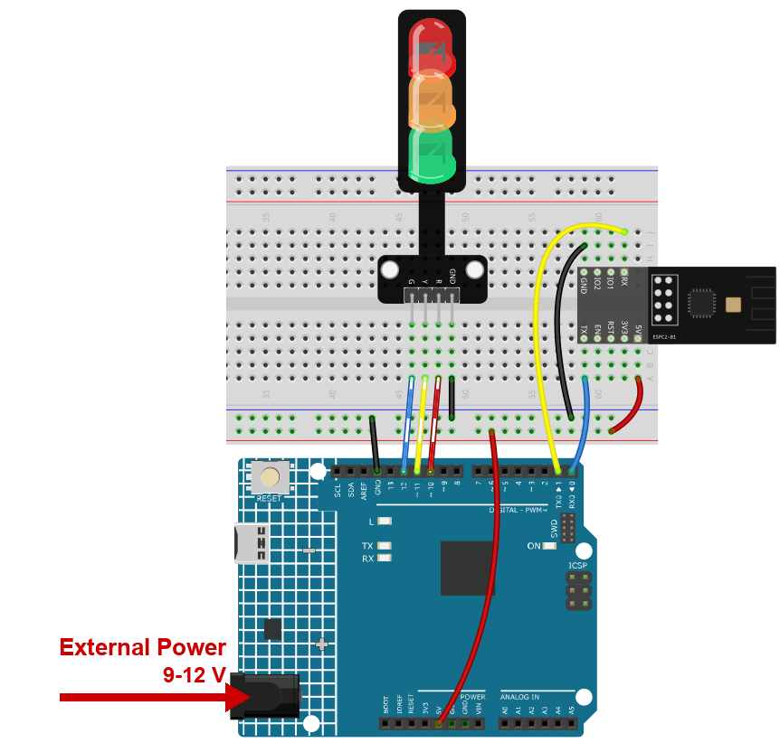

.. note::

    Hallo und willkommen in der SunFounder Raspberry Pi & Arduino & ESP32 Enthusiasten-Gemeinschaft auf Facebook! Tauchen Sie tiefer ein in die Welt von Raspberry Pi, Arduino und ESP32 mit anderen Enthusiasten.

    **Warum beitreten?**

    - **Expertenunterstützung**: Lösen Sie Nachverkaufsprobleme und technische Herausforderungen mit Hilfe unserer Gemeinschaft und unseres Teams.
    - **Lernen & Teilen**: Tauschen Sie Tipps und Anleitungen aus, um Ihre Fähigkeiten zu verbessern.
    - **Exklusive Vorschauen**: Erhalten Sie frühzeitigen Zugang zu neuen Produktankündigungen und exklusiven Einblicken.
    - **Spezialrabatte**: Genießen Sie exklusive Rabatte auf unsere neuesten Produkte.
    - **Festliche Aktionen und Gewinnspiele**: Nehmen Sie an Gewinnspielen und Feiertagsaktionen teil.

    👉 Sind Sie bereit, mit uns zu erkunden und zu erschaffen? Klicken Sie auf [|link_sf_facebook|] und treten Sie heute bei!

.. _c201_iot_Bluetooth_traffic_light:

9. Bluetooth-Ampel
===================

Drei LEDs stehen für eine Ampel. Ein Buchstabe vom Handy schaltet das Licht um: **R** für
Rot, **Y** für Gelb, **G** für Grün.

Das ist das erste Projekt, in dem das Handy einen **Befehl** statt Text sendet - und der
ist viel kürzer, als Sie vielleicht erwarten. Der Sketch schaut auf einzelne Zeichen, ein
Brief ist also schon eine vollständige Nachricht.

1. Schaltung aufbauen
-----------------------------

.. note::

    Das Modul zieht beim Start einen hohen Strom. Stecken Sie deshalb die 9-V-Batterie
    bzw. das externe Netzteil in die Hohlbuchse des R4 Minima.

* :ref:`cpn_uno`
* :ref:`cpn_espc201`
* :ref:`cpn_traffic`

2. Code hochladen
-----------------------------

#. Öffnen Sie die Datei ``09-Bluetooth_traffic_light.ino`` unter dem Pfad ``ultimate-sensor-kit\code\iot_project_espc201\bluetooth\09-Bluetooth_traffic_light``.

#. Wählen Sie **Arduino UNO R4 Minima** und den richtigen Port und klicken Sie auf
   **Upload**.

#. Öffnen Sie den Seriellen Monitor mit **115200**. Nach den beiden Bluetooth-Zeilen wird
   hier jeder Buchstabe ausgegeben, den Sie vom Handy senden - sehr nützlich, wenn scheinbar
   nichts passiert.

3. Das Licht vom Handy steuern
------------------------------

Nutzen Sie **LightBlue**, dieselbe App wie im Einsteigerkapitel.

#. Öffnen Sie LightBlue, tippen Sie auf **Scan** und verbinden Sie sich mit
   **SunFounder-C2**. Klappen Sie dann den Dienst **0xA002** auf und öffnen Sie die
   Characteristic **C304**. Der rote Rahmen zeigt die Schaltfläche, die Sie brauchen.

   .. image:: ../img/ble_lightblue_write.png
      :width: 80%

#. Tippen Sie auf **Write new value**, stellen Sie das Format oben rechts auf
   **UTF-8 String**, geben Sie ein einzelnes großes ``R`` ein und senden Sie es.

   .. image:: ../img/ble_lightblue_R.png
      :width: 80%

#. Die rote LED leuchtet, die beiden anderen gehen aus.

   * Senden Sie ``Y`` - Gelb. Senden Sie ``G`` - Grün.
   * Ein Buchstabe genügt, ein längeres Wort schadet aber nicht: Der Sketch reagiert nur
     auf die Zeichen, die er kennt. Tippen Sie ``RED``, wirkt das ``R`` trotzdem.
   * Ein kleines ``r`` funktioniert **nicht** - der Sketch vergleicht nur mit
     Großbuchstaben.

#. Beobachten Sie den Seriellen Monitor beim Senden: Jedes empfangene Zeichen wird in
   einer eigenen Zeile ausgegeben, Sie sehen also immer, ob das Handy die Platine erreicht
   hat.

4. Code-Erklärung
-----------------------------

#. **Die drei LEDs**

   .. code-block:: arduino

      const int rledPin = 10;   // rot
      const int yledPin = 11;   // gelb
      const int gledPin = 12;   // grün

#. **Bluetooth, wieder in einer Zeile**

   .. code-block:: arduino

      #include "SunFounder_BLE.h"
      BLEStream bleSerial;

   Dasselbe Objekt wie im vorigen Kapitel. ``bleSerial.begin()`` lässt das Modul als
   **SunFounder-C2** werben; das Handy schreibt in **C304**, und alles Ankommende lässt
   sich mit ``bleSerial.read()`` lesen.

#. **setup()**

   .. code-block:: arduino

      void setup() {
        pinMode(rledPin, OUTPUT);
        pinMode(yledPin, OUTPUT);
        pinMode(gledPin, OUTPUT);

        Serial.begin(115200);
        bleSerial.begin();
      }

#. **loop() - ein Zeichen nach dem anderen**

   .. code-block:: arduino

      while (bleSerial.available() > 0) {
        character = bleSerial.read();
        Serial.println(character);

        if (character == 'R') {
          toggleLights(rledPin);
        } else if (character == 'Y') {
          toggleLights(yledPin);
        } else if (character == 'G') {
          toggleLights(gledPin);
        }
      }

   ``while`` statt ``if`` ist Absicht: Zwischen zwei Durchläufen der Schleife können
   mehrere Zeichen ankommen, so bleibt keines im Puffer liegen.

   Die Anführungszeichen sind wichtig - ``'R'`` ist der Buchstabe R, ``"R"`` wäre ein Text
   aus einem Zeichen.

#. **toggleLights()**

   .. code-block:: arduino

      void toggleLights(int targetLight) {
        digitalWrite(rledPin, LOW);
        digitalWrite(yledPin, LOW);
        digitalWrite(gledPin, LOW);

        digitalWrite(targetLight, HIGH);
      }

   Zuerst werden alle drei ausgeschaltet, dann die gewünschte eingeschaltet. Genau das
   macht eine Ampel glaubwürdig: Es leuchtet immer nur eine Lampe.
