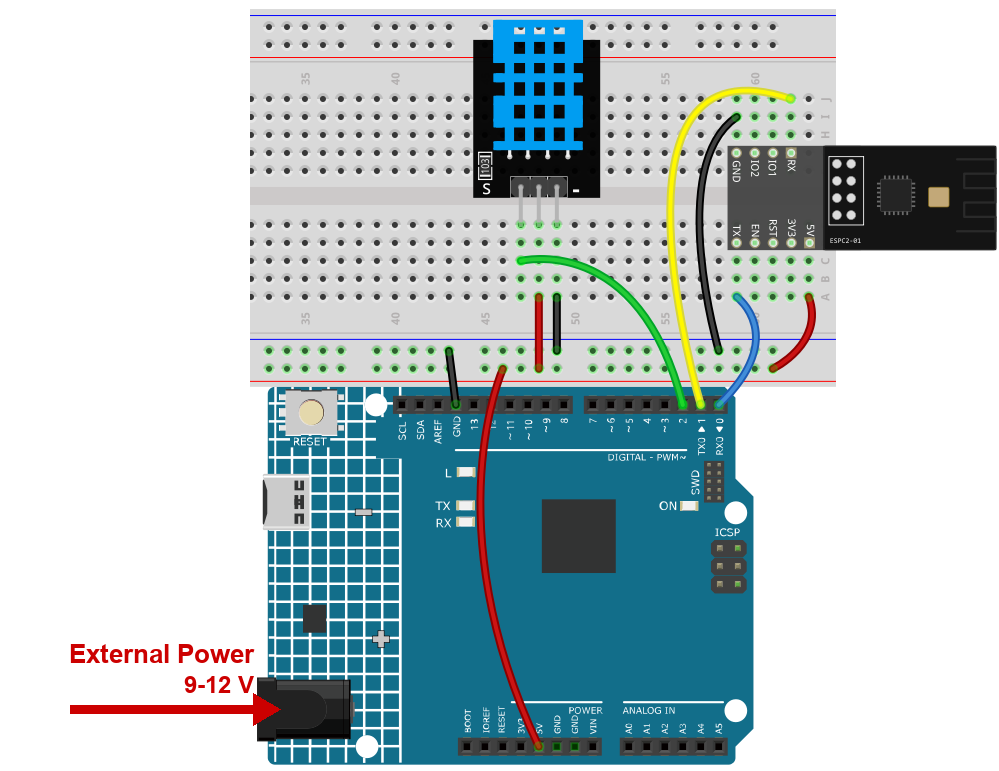

.. note::

    Hallo und willkommen in der SunFounder Raspberry Pi & Arduino & ESP32 Enthusiasten-Gemeinschaft auf Facebook! Tauchen Sie tiefer ein in die Welt von Raspberry Pi, Arduino und ESP32 mit anderen Enthusiasten.

    **Warum beitreten?**

    - **Expertenunterstützung**: Lösen Sie Nachverkaufsprobleme und technische Herausforderungen mit Hilfe unserer Gemeinschaft und unseres Teams.
    - **Lernen & Teilen**: Tauschen Sie Tipps und Anleitungen aus, um Ihre Fähigkeiten zu verbessern.
    - **Exklusive Vorschauen**: Erhalten Sie frühzeitigen Zugang zu neuen Produktankündigungen und exklusiven Einblicken.
    - **Spezialrabatte**: Genießen Sie exklusive Rabatte auf unsere neuesten Produkte.
    - **Festliche Aktionen und Gewinnspiele**: Nehmen Sie an Gewinnspielen und Feiertagsaktionen teil.

    👉 Sind Sie bereit, mit uns zu erkunden und zu erschaffen? Klicken Sie auf [|link_sf_facebook|] und treten Sie heute bei!

.. _c201_iot_Bluetooth_environmental_monitor:

10. Bluetooth-Umgebungsmonitor
==================================

Ein DHT11 misst die Luft, und die Platine schickt die beiden Werte alle zwei Sekunden
aufs Handy. Das ist das **erste Projekt, das Daten in die andere Richtung schickt**:
Bisher hat das Handy gesprochen und die Platine zugehört. Hier spricht die Platine.

1. Schaltung aufbauen
-----------------------------

.. note::

    Das Modul zieht beim Start einen hohen Strom. Stecken Sie deshalb die 9-V-Batterie
    bzw. das externe Netzteil in die Hohlbuchse des R4 Minima.

* :ref:`cpn_uno`
* :ref:`cpn_espc201`
* :ref:`cpn_dht11`

2. Code hochladen
-----------------------------

#. Öffnen Sie die Datei ``10-Bluetooth_environmental_monitor.ino`` unter dem Pfad ``ultimate-sensor-kit\code\iot_project_espc201\bluetooth\10-Bluetooth_environmental_monitor``.

   .. note::

      Installieren Sie die **DHT sensor library** (von Adafruit) und die zugehörige
      **Adafruit Unified Sensor** aus dem Bibliotheksverwalter.

#. Wählen Sie **Arduino UNO R4 Minima** und den richtigen Port und klicken Sie auf
   **Upload**.

#. Öffnen Sie den Seriellen Monitor mit **115200**. Alle zwei Sekunden erscheint eine
   Zeile wie diese:

   .. code-block:: text

      Humidity: 45.00%  Temperature: 27.00 C
      Data to send: 27.00,45.00

   Diese Zeile entsteht auch ohne Handy - praktisch, denn damit ist bewiesen, dass der
   Sensor arbeitet, bevor Sie nach einem Bluetooth-Problem suchen.

3. Die Daten in LightBlue ansehen
------------------------------

Diesmal schreiben Sie nichts - Sie **abonnieren**. Abonnieren heißt: Das Handy hält
diese Characteristic offen und zeigt alles, was ankommt.

#. Öffnen Sie LightBlue, tippen Sie auf **Scan** und verbinden Sie sich mit
   **SunFounder-C2**.

#. Klappen Sie den Dienst **0xA002** auf und öffnen Sie die Characteristic **C305**.

#. Tippen Sie auf **Subscribe**. Die Zahlen erscheinen von selbst, zweimal pro Sekunde:

   .. image:: ../img/ble_lightblue_subs.png
      :width: 80%

   .. note::

      Das Format ist ``Temperatur,Luftfeuchte``. ``27.00,45.00`` bedeutet 27 Grad und 45 %
      Luftfeuchte. Ein Komma trennt beide Werte, damit die Gegenseite die Zeile in zwei
      Zahlen zerlegen kann.

#. Halten Sie Ihre Hand über den Sensor - die Luftfeuchte steigt innerhalb von Sekunden.

   .. note::

      Kommt nichts an, prüfen Sie zwei Dinge: dass Sie **C305** geöffnet haben (nicht
      C304) und dass im Seriellen Monitor noch ``Data to send:`` erscheint. Ist der
      Serielle Monitor still, liegt das Problem am Sensor oder an seiner Verkabelung,
      nicht an Bluetooth.

4. Code-Erklärung
-----------------------------

#. **Den Sensor lesen**

   .. code-block:: arduino

      float humidity = dht.readHumidity();
      float temperature = dht.readTemperature();

      if (isnan(humidity) || isnan(temperature)) {
        Serial.println(F("Failed to read from DHT sensor!"));
        return;
      }

   ``isnan`` heißt "is not a number". Ein nicht korrekt angeschlossener DHT11 liefert
   genau das, deshalb bricht der Sketch ab, bevor er eine leere Zeile ans Handy schickt.

#. **Eine Zeile, zwei Werte**

   .. code-block:: arduino

      sensorData = String(temperature) + "," + String(humidity);
      bleSerial.println(sensorData);

   ``bleSerial.println`` schreibt den Text und einen Zeilenumbruch, genau wie
   ``Serial.println``. ``BLEStream`` zerlegt ihn in 20-Byte-Blöcke und schickt jeden als
   **Notification auf C305** - deshalb muss das Handy abonnieren.

#. **Der Zwei-Sekunden-Takt**

   .. code-block:: arduino

      void loop() {
        delay(2000);
        ...
      }

   ``delay`` ist hier erlaubt, weil der Sketch sonst nichts tut. In den WLAN-Projekten
   haben wir es vermieden, weil Blynk ständig bedient werden muss; Bluetooth braucht
   keine solche Hintergrundarbeit.

#. **Warum die Platine ungefragt senden kann**

   Eine BLE-Notification läuft nur, wenn das Handy diese Characteristic abonniert hat.
   Nirgends im Sketch steht "hört jemand zu" - ohne Abonnement verschwinden die Daten
   einfach. Genau deshalb sehen Sie in LightBlue erst nach **Subscribe** etwas.
