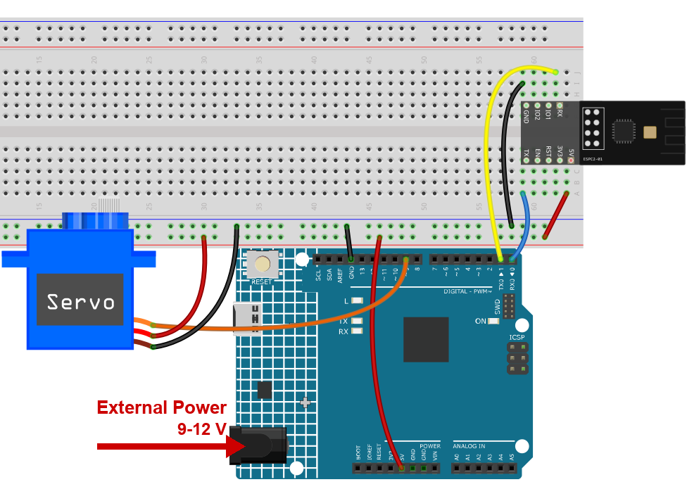

.. note::

    Hallo und willkommen in der SunFounder Raspberry Pi & Arduino & ESP32 Enthusiasten-Gemeinschaft auf Facebook! Tauchen Sie tiefer ein in die Welt von Raspberry Pi, Arduino und ESP32 mit anderen Enthusiasten.

    **Warum beitreten?**

    - **Expertenunterstützung**: Lösen Sie Nachverkaufsprobleme und technische Herausforderungen mit Hilfe unserer Gemeinschaft und unseres Teams.
    - **Lernen & Teilen**: Tauschen Sie Tipps und Anleitungen aus, um Ihre Fähigkeiten zu verbessern.
    - **Exklusive Vorschauen**: Erhalten Sie frühzeitigen Zugang zu neuen Produktankündigungen und exklusiven Einblicken.
    - **Spezialrabatte**: Genießen Sie exklusive Rabatte auf unsere neuesten Produkte.
    - **Festliche Aktionen und Gewinnspiele**: Nehmen Sie an Gewinnspielen und Feiertagsaktionen teil.

    👉 Sind Sie bereit, mit uns zu erkunden und zu erschaffen? Klicken Sie auf [|link_sf_facebook|] und treten Sie heute bei!

.. _c201_iot_Bluetooth_lock_controller:

11. Bluetooth-Schloss
=====================

Ein Servomotor steht für den Riegel eines Schlosses. Ein Zeichen vom Handy dreht ihn:
``1`` schließt, ``0`` öffnet.

Für ein Schloss genügen zwei Zustände, deshalb braucht der Sketch kein Abschlusszeichen -
jedes ankommende Zeichen ist schon ein vollständiger Befehl.

1. Schaltung aufbauen
-----------------------------

.. note::

    Das Modul zieht beim Start einen hohen Strom. Stecken Sie deshalb die 9-V-Batterie
    bzw. das externe Netzteil in die Hohlbuchse des R4 Minima. Ein Servo hat seinen eigenen
    Stromstoß - versorgen Sie ihn nie über den 5-V-Pin der Platine.

* :ref:`cpn_uno`
* :ref:`cpn_espc201`
* :ref:`cpn_servo`

2. Code hochladen
-----------------------------

#. Öffnen Sie die Datei ``11-Bluetooth_lock_controller.ino`` unter dem Pfad ``ultimate-sensor-kit\code\iot_project_espc201\bluetooth\11-Bluetooth_lock_controller``.

   .. note::

      Der Sketch braucht die Bibliothek **Servo**. Sie gehört schon zur Arduino IDE, meist
      ist also nichts zu installieren.

#. Wählen Sie **Arduino UNO R4 Minima** und den richtigen Port und klicken Sie auf
   **Upload**.

#. Der Serielle Monitor mit **115200** zeigt die beiden Bluetooth-Zeilen und danach eine
   Zeile für jeden Befehl:

   .. code-block:: text

      === ESPC2-01 Bluetooth (BLE) ===
      [OK] BLE is ready - scan for "SunFounder-C2" on your phone
      --------------------------------
      Locked
      Unlocked

3. Vom Handy schließen und öffnen
------------------------------

#. Öffnen Sie LightBlue, tippen Sie auf **Scan** und verbinden Sie sich mit
   **SunFounder-C2**.

#. Klappen Sie den Dienst **0xA002** auf und öffnen Sie die Characteristic **C304**. Die
   Schaltfläche, die Sie brauchen, liegt im roten Rahmen.

   .. image:: ../img/ble_lightblue_write.png
      :width: 80%

#. Tippen Sie auf **Write new value**, stellen Sie das Format oben rechts auf
   **UTF-8 String** und geben Sie ``1`` ein. Das Bild zeigt das Feld kurz vor dem Senden:

   .. image:: ../img/ble_lightblue_1.png
      :width: 80%

#. Senden Sie es. Der Servo dreht in die geschlossene Position und der Serielle Monitor
   schreibt ``Locked``.

#. Geben Sie stattdessen ``0`` ein und senden Sie - der Servo schwingt zurück und der
   Monitor schreibt ``Unlocked``. Das Bild zeigt das Feld erneut:

   .. image:: ../img/ble_lightblue_0.png
      :width: 80%

   .. note::

      Die Winkel liegen als ``lockAngle`` und ``unlockAngle`` oben im Sketch. Bewegt sich
      Ihr Riegel falsch herum, tauschen Sie die beiden Zahlen, statt das Horn von Hand zu
      drehen - das lässt sich leichter rückgängig machen.

4. Code-Erklärung
-----------------------------

#. **Der Servo**

   .. code-block:: arduino

      #include <Servo.h>
      Servo myservo;

      const int lockAngle = 0;
      const int unlockAngle = 90;

   ``myservo.write(angle)`` fährt das Horn auf eine Position zwischen 0 und 180 Grad und
   hält sie dort. Er dreht nicht durchgehend - genau das braucht ein Riegel.

#. **Auf ein Zeichen warten**

   .. code-block:: arduino

      if (bleSerial.available() > 0) {
        char message = bleSerial.read();

        if (message == '1') {
          myservo.write(lockAngle);
          Serial.println("Locked");
        } else if (message == '0') {
          myservo.write(unlockAngle);
          Serial.println("Unlocked");
        }
      }

   ``bleSerial.read()`` liefert **ein** Zeichen, deshalb muss das Handy ``1`` senden und
   nicht ``Lock``. Alles, was nicht ``1`` oder ``0`` ist, wird ohne Meldung ignoriert.

   .. note::

      ``'1'`` mit einfachen Anführungszeichen ist ein Zeichen; ``"1"`` mit doppelten wäre
      ein Text aus einem Zeichen, und der Vergleich würde nicht kompilieren.

#. **Warum kein Abschlusszeichen nötig ist**

   Jeder Befehl ist hier genau ein Zeichen lang, der Sketch kann also nicht aus dem Tritt
   geraten. Im Piano- und im OLED-Projekt sind die Nachrichten länger, dort ist ein
   Abschlusszeichen Pflicht - achten Sie auf ``*`` und ``#`` in den nächsten Kapiteln.
