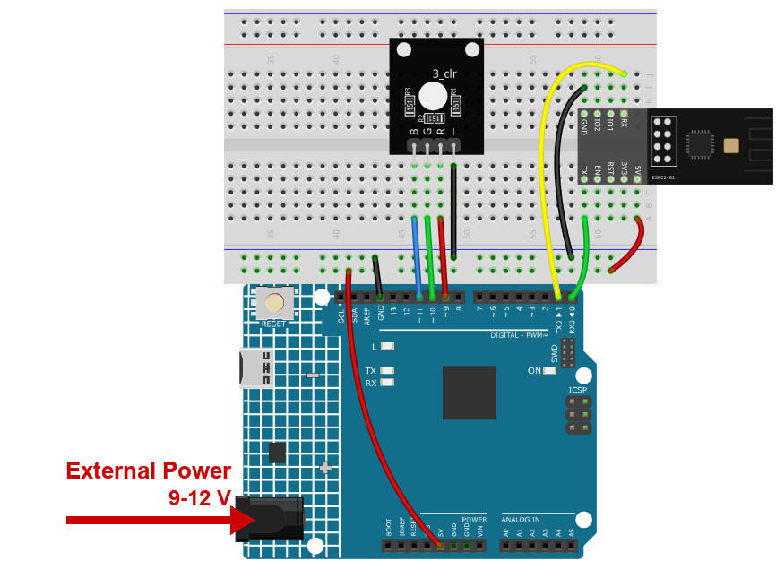

.. note::

    こんにちは、SunFounderのRaspberry Pi & Arduino & ESP32愛好家コミュニティへようこそ！Facebook上でRaspberry Pi、Arduino、ESP32についてもっと深く掘り下げ、他の愛好家と交流しましょう。

    **参加する理由は？**

    - **エキスパートサポート**：コミュニティやチームの助けを借りて、販売後の問題や技術的な課題を解決します。
    - **学び＆共有**：ヒントやチュートリアルを交換してスキルを向上させましょう。
    - **独占的なプレビュー**：新製品の発表や先行プレビューに早期アクセスしましょう。
    - **特別割引**：最新製品の独占割引をお楽しみください。
    - **祭りのプロモーションとギフト**：ギフトや祝日のプロモーションに参加しましょう。

    👉 私たちと一緒に探索し、創造する準備はできていますか？[|link_sf_facebook|]をクリックして今すぐ参加しましょう！

.. _c201_iot_Bluetooth_RGB_controller:

12. Bluetooth RGB 制御
============================

1 つのメッセージが 3 つの数値を運びます。赤をどれだけ、緑をどれだけ、青をどれだけ。
``R255G128B0`` を送ると LED はオレンジになります。

Bluetooth 編で最初の **構造化された** メッセージです。スケッチは使う前に 3 つに分
ける必要があります。

1. 回路を組み立てる
-----------------------------

.. note::

   モジュールは起動時に大きな電流を引きます。9V 電池または外部電源を R4 Minima
   の DC ジャックに必ず接続してください。

* :ref:`cpn_uno`
* :ref:`cpn_espc201`
* :ref:`cpn_rgb`

2. コードを書き込む
-----------------------------

#. ``12-Bluetooth_RGB_controller.ino`` を ``ultimate-sensor-kit\code\iot_project_espc201\bluetooth\12-Bluetooth_RGB_controller`` から開きます。

#. **Arduino UNO R4 Minima** と正しいポートを選び、**Upload** をクリックします。

#. シリアルモニターを **115200** で開きます。メッセージが完全に届くと 1 度だけ表示
   されるので、ボードが何を理解したかが正確に分かります。

   .. code-block:: text

      colour: R255G128B0

3. スマートフォンから色を変える
-------------------------------

#. LightBlue を開き **Scan** をタップして **SunFounder-C2** に接続します。

#. サービス **0xA002** を展開し、Characteristic **C304** を開きます。赤い枠が押す
   ボタンです。

   .. image:: ../img/ble_lightblue_write.png
      :width: 80%

#. **Write new value** をタップし、右上の形式を **UTF-8 String** にして
   ``R255G128B0`` を入力します。図は送信直前の入力欄です。

   .. image:: ../img/ble_lightblue_rgb.png
      :width: 80%

#. 送信すると LED がオレンジになり、シリアルモニターに ``colour: R255G128B0`` と出
   ます。

   .. note::

      スケッチは 1 文字ごとに反応するわけではありません。BLE の書き込みは途中でいく
      つかに分かれることがあるので、スケッチはメッセージが完全になるまで待ちます -
      末尾の ``#``、または **120ms** の無音 - その後で色を設定します。1 かたまりごと
      に反応していたら、送るたびに LED が間違った色でちらつきます。

#. ほかの色も試してください。入力欄は開いたままなので、続けて送れます。

   .. list-table::
      :header-rows: 1
      :widths: 30 70

      * - 送る内容
        - 結果
      * - ``R255G0B0``
        - 赤
      * - ``R0G255B0``
        - 緑
      * - ``R0G0B255``
        - 青
      * - ``R255G255B255``
        - 白（3 チャネルとも最大）
      * - ``R0G0B0``
        - 消灯

   .. note::

      数値は **0〜255** で、パーセントではありません。``R128G0B0`` は ``R255G0B0``
      より暗い赤です。ピンが点いている時間が半分だからです。

      メッセージ全体は **20 文字** 未満にしてください。だから区切り文字を入れていませ
      ん。

4. コードの説明
-----------------------------

#. **3 本のピン、1 つの色**

   .. code-block:: arduino

      const int redPin = 9;
      const int greenPin = 10;
      const int bluePin = 11;

   ``analogWrite(pin, 0..255)`` は PWM を使うので、3 原色だけでなく多くの色を出せま
   す。

#. **メッセージを分解する**

   .. code-block:: arduino

      int extract(const String& m, char marker) {
        int at = m.indexOf(marker);
        if (at < 0) return -1;
        ...
      }

   ``extract`` は **R**、**G**、**B** の文字を探し、その後の数字を別の文字が来るまで
   読みます。``extract("R255G128B0", 'G')`` は ``128`` を返します。だから
   ``R...G...B...`` の順番が重要で、括弧は要りません。

#. **テキストから数値へ**

   .. code-block:: arduino

      if (r >= 0) analogWrite(redPin,   constrain(r, 0, 255));
      if (g >= 0) analogWrite(greenPin, constrain(g, 0, 255));
      if (b >= 0) analogWrite(bluePin,  constrain(b, 0, 255));

   ``constrain`` は値を 0〜255 に制限します。文字が抜けていれば ``-1`` のままで、その
   色は変更されません。

#. **メッセージが完成するまで待つ**

   .. code-block:: arduino

      if (c == '#' || c == '\r' || c == '\n') {
        applyMessage();
        continue;
      }
      if (message.length() < 20) message += c;

      // # が来なければ、短い無音を終わりとみなす
      if (message.length() > 0 && millis() - lastByte > 120) {
        applyMessage();
      }

   文字は評価せずに集めます。``#`` か 120ms の無音でメッセージが終わり、そこで色を設
   定してバッファを空にします。
