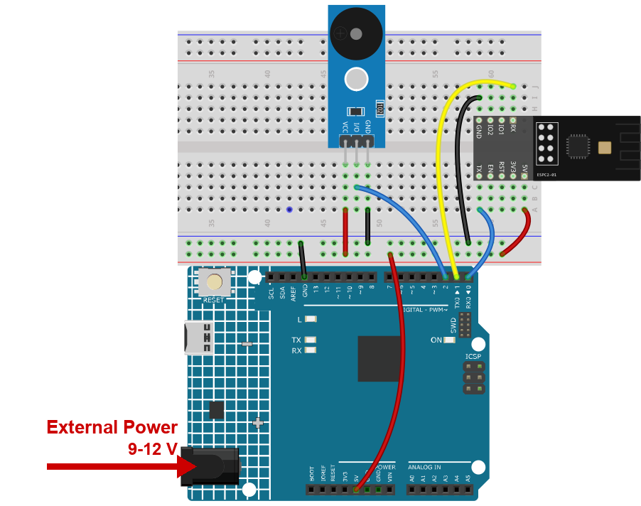

.. note::

    Hallo und willkommen in der SunFounder Raspberry Pi & Arduino & ESP32 Enthusiasten-Gemeinschaft auf Facebook! Tauchen Sie tiefer ein in die Welt von Raspberry Pi, Arduino und ESP32 mit anderen Enthusiasten.

    **Warum beitreten?**

    - **Expertenunterstützung**: Lösen Sie Nachverkaufsprobleme und technische Herausforderungen mit Hilfe unserer Gemeinschaft und unseres Teams.
    - **Lernen & Teilen**: Tauschen Sie Tipps und Anleitungen aus, um Ihre Fähigkeiten zu verbessern.
    - **Exklusive Vorschauen**: Erhalten Sie frühzeitigen Zugang zu neuen Produktankündigungen und exklusiven Einblicken.
    - **Spezialrabatte**: Genießen Sie exklusive Rabatte auf unsere neuesten Produkte.
    - **Festliche Aktionen und Gewinnspiele**: Nehmen Sie an Gewinnspielen und Feiertagsaktionen teil.

    👉 Sind Sie bereit, mit uns zu erkunden und zu erschaffen? Klicken Sie auf [|link_sf_facebook|] und treten Sie heute bei!

.. _c201_iot_Bluetooth_piano:

13. Bluetooth-Klavier
=====================

Ein Summer wird zum Klavier. Senden Sie ``NOTE_C4*``, und er spielt ein C für eine
Fünftelsekunde.

Interessant ist der Stern: Er markiert das **Ende** einer Nachricht, damit der Sketch
weiß, wann ein vollständiger Notenname da ist - sonst würde er schon bei ``NOTE_C``
versuchen zu spielen.

1. Schaltung aufbauen
-----------------------------

.. note::

    Das Modul zieht beim Start einen hohen Strom. Stecken Sie deshalb die 9-V-Batterie
    bzw. das externe Netzteil in die Hohlbuchse des R4 Minima.

* :ref:`cpn_uno`
* :ref:`cpn_espc201`
* :ref:`cpn_buzzer`

2. Code hochladen
-----------------------------

#. Öffnen Sie die Datei ``13-Bluetooth_piano.ino`` unter dem Pfad ``ultimate-sensor-kit\code\iot_project_espc201\bluetooth\13-Bluetooth_piano``.

#. Wählen Sie **Arduino UNO R4 Minima** und den richtigen Port und klicken Sie auf
   **Upload**.

#. Öffnen Sie den Seriellen Monitor mit **115200**: Jede Note wird ohne Stern
   ausgegeben.

   .. code-block:: text

      NOTE_C4

3. Eine Note vom Handy spielen
------------------------------

#. Öffnen Sie LightBlue, tippen Sie auf **Scan** und verbinden Sie sich mit
   **SunFounder-C2**, dann Dienst **0xA002** und Characteristic **C304**.

#. Tippen Sie auf **Write new value**, stellen Sie das Format oben rechts auf
   **UTF-8 String** und geben Sie ``NOTE_C4*`` ein. Das Bild zeigt das Feld kurz vor dem
   Senden:

   .. image:: ../img/ble_lightblue_note.png
      :width: 80%

#. Senden Sie es. Der Summer spielt etwa 0,2 Sekunden ein C und der Serielle Monitor
   schreibt ``NOTE_C4`` - der Stern wird benutzt und dann entfernt.

#. Diese acht Noten stehen zur Verfügung:

   .. list-table::
      :header-rows: 1
      :widths: 40 60

      * - Senden Sie
        - Note
      * - ``NOTE_C4*``, ``NOTE_D4*``, ``NOTE_E4*``
        - tiefes C, D, E
      * - ``NOTE_F4*``, ``NOTE_G4*``, ``NOTE_A4*``, ``NOTE_B4*``
        - F, G, A, B
      * - ``NOTE_C5*``
        - C eine Oktave höher

   .. note::

      **Vergessen Sie den Stern nicht.** Ohne ihn wartet der Sketch weiter auf das Ende
      der Nachricht, es erklingt nichts und der Serielle Monitor zeigt ebenfalls nichts.

4. Code-Erklärung
-----------------------------

#. **Der Summer**

   .. code-block:: arduino

      tone(buzzerPin, NOTE_C4);
      delay(200);
      noTone(buzzerPin);

   ``tone(pin, frequency)`` startet eine Rechteckwelle mit dieser Frequenz - ein einfacher
   Piezo-Summer gibt sie als Ton aus. ``NOTE_C4`` ist keine Pinnummer, sondern eine
   Frequenz, die der Arduino-Kern mitbringt.

#. **Zeichen sammeln bis zum Stern**

   .. code-block:: arduino

      while (bleSerial.available() > 0) {
        character = bleSerial.read();
        noteType = noteType + character;

        if (character == '*') {
          noteType = noteType.substring(0, noteType.length() - 1);
          ...
        }
      }

   Die Zeichen werden einzeln gesammelt. Der Stern ist gleichzeitig Auslöser **und**
   etwas, das entfernt werden muss: ``substring(0, length()-1)`` schneidet das letzte
   Zeichen ab, aus ``NOTE_C4*`` wird ``NOTE_C4``.

#. **Text vergleichen**

   .. code-block:: arduino

      if (noteType == "NOTE_C4") { tone(buzzerPin, NOTE_C4); }
      else if (noteType == "NOTE_D4") { ... }

   Text wird mit doppelten Anführungszeichen und mit ``==`` verglichen. Ein einzelnes
   ``=`` würde zuweisen statt vergleichen; das kompiliert, funktioniert aber nie.

#. **Nach jeder Note zurücksetzen**

   .. code-block:: arduino

      noteType = "";
      delay(200);
      noTone(buzzerPin);

   Das Leeren von ``noteType`` ist wesentlich: Ohne es würde die nächste Note an die
   vorige gehängt und kein Vergleich träfe mehr zu.
