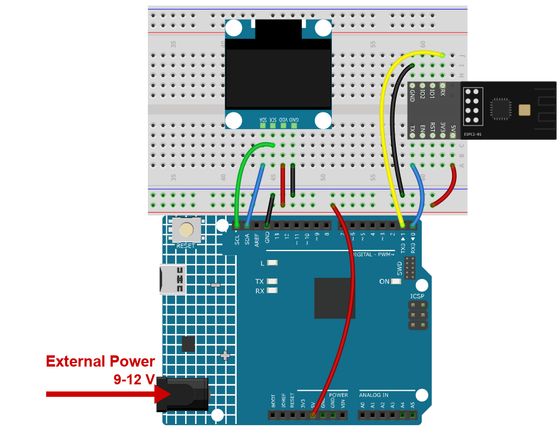

.. note::

    Hallo und willkommen in der SunFounder Raspberry Pi & Arduino & ESP32 Enthusiasten-Gemeinschaft auf Facebook! Tauchen Sie tiefer ein in die Welt von Raspberry Pi, Arduino und ESP32 mit anderen Enthusiasten.

    **Warum beitreten?**

    - **Expertenunterstützung**: Lösen Sie Nachverkaufsprobleme und technische Herausforderungen mit Hilfe unserer Gemeinschaft und unseres Teams.
    - **Lernen & Teilen**: Tauschen Sie Tipps und Anleitungen aus, um Ihre Fähigkeiten zu verbessern.
    - **Exklusive Vorschauen**: Erhalten Sie frühzeitigen Zugang zu neuen Produktankündigungen und exklusiven Einblicken.
    - **Spezialrabatte**: Genießen Sie exklusive Rabatte auf unsere neuesten Produkte.
    - **Festliche Aktionen und Gewinnspiele**: Nehmen Sie an Gewinnspielen und Feiertagsaktionen teil.

    👉 Sind Sie bereit, mit uns zu erkunden und zu erschaffen? Klicken Sie auf [|link_sf_facebook|] und treten Sie heute bei!

.. _c201_iot_Bluetooth_oled:

14. Bluetooth-OLED
==================

Tippen Sie auf dem Handy, lesen Sie es auf einem 128 x 64-OLED. Dieses Projekt ähnelt dem
LCD-Projekt, aber das Display ist kleiner und der Sketch muss erraten, wann ein Satz
fertig ist - das Handy sendet die Zeichen nacheinander, nicht als Block.

1. Schaltung aufbauen
-----------------------------

.. note::

    Das Modul zieht beim Start einen hohen Strom. Stecken Sie deshalb die 9-V-Batterie
    bzw. das externe Netzteil in die Hohlbuchse des R4 Minima.

* :ref:`cpn_uno`
* :ref:`cpn_espc201`
* :ref:`cpn_olde`

2. Code hochladen
-----------------------------

#. Öffnen Sie die Datei ``14-Bluetooth_oled.ino`` unter dem Pfad ``ultimate-sensor-kit\code\iot_project_espc201\bluetooth\14-Bluetooth_oled``.

   .. note::

      Installieren Sie **Adafruit SSD1306** und **Adafruit GFX Library** aus dem
      Bibliotheksverwalter.

#. Wählen Sie **Arduino UNO R4 Minima** und den richtigen Port und klicken Sie auf
   **Upload**.

#. Öffnen Sie den Seriellen Monitor mit **115200** - der gesendete Text erscheint auch
   dort.

3. Text vom Handy senden
------------------------------

#. Öffnen Sie LightBlue, tippen Sie auf **Scan** und verbinden Sie sich mit
   **SunFounder-C2**, dann Dienst **0xA002** und Characteristic **C304**.

#. Tippen Sie auf **Write new value**, stellen Sie das Format oben rechts auf
   **UTF-8 String** und geben Sie ``Hello`` ein. Das Bild zeigt das Feld kurz vor dem
   Senden:

   .. image:: ../img/ble_lightblue_hello.png
      :width: 80%

#. Senden Sie es. Das Wort erscheint auf dem OLED und im Seriellen Monitor.

#. Senden Sie ein anderes Wort - es ersetzt das erste, das Display scrollt nicht.

   .. note::

      Zwei Regeln entscheiden, wann die Nachricht vollständig ist: entweder Sie beenden
      sie mit ``#``, oder Sie hören einfach auf zu tippen. Der Sketch wartet **120 ms**
      Ruhe und nimmt dann das, was da ist, als eine Nachricht.

      Das Display ist 21 Zeichen breit und 4 Zeilen hoch. Längerer Text wird
      abgeschnitten.

4. Code-Erklärung
-----------------------------

#. **Das Display**

   .. code-block:: arduino

      display.begin(SSD1306_SWITCHCAPVCC, 0x3C);
      display.clearDisplay();
      display.setTextSize(1);
      display.setTextColor(SSD1306_WHITE);
      display.setCursor(0, 0);
      display.print(message);
      display.display();

   ``0x3C`` ist die I2C-Adresse des Moduls. Erst ``display.display()`` schiebt den Inhalt
   aufs Glas - der Sketch schreibt zuerst in einen Puffer und überträgt ihn dann in einem
   Zug.

#. **Wann ist der Text fertig**

   .. code-block:: arduino

      if (c == '#' || c == '\r' || c == '\n') {
        showMessage();
        continue;
      }
      message += c;
      lastByte = millis();

   Ein ``#`` beendet die Nachricht sofort. Ein Zeilenende tut dasselbe, weil manche Apps
   automatisch eines anhängen.

#. **Die 120-ms-Regel**

   .. code-block:: arduino

      if (message.length() > 0 && millis() - lastByte > 120) {
        showMessage();
      }

   BLE sendet die Zeichen einer Eingabe in einem Schub, mit kaum Abstand. Wenn der Schub
   endet, vergehen 120 ms und der Sketch zeigt an, was er hat. Dadurch fühlt sich das
   Tippen am Handy natürlich an, ohne dass Sie etwas bestätigen müssen.

#. **Danach leeren**

   .. code-block:: arduino

      message = "";

   Ohne das würde das nächste Wort an das alte gehängt und das Display würde immer länger
   werden, bis es abgeschnitten wird.
