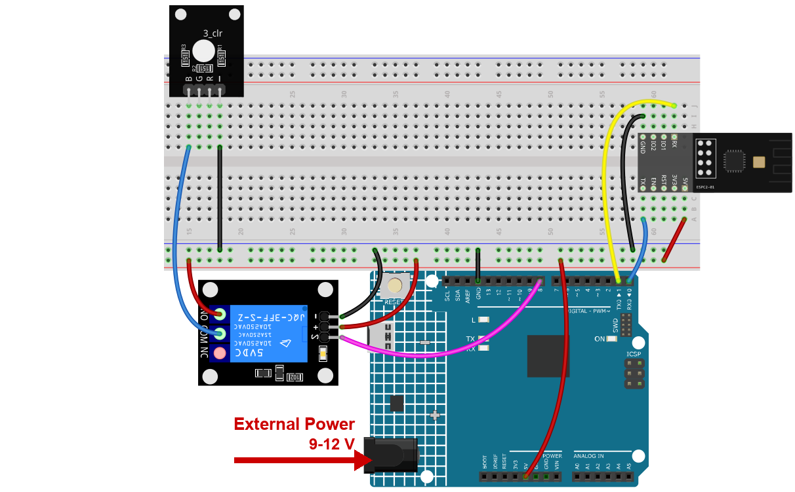

.. note::

    Hello, welcome to the SunFounder Raspberry Pi & Arduino & ESP32 Enthusiasts Community on Facebook! Dive deeper into Raspberry Pi, Arduino, and ESP32 with fellow enthusiasts.

    **Why Join?**

    - **Expert Support**: Solve real-life coding problems and technical challenges with our community and team.
    - **Learn & Share**: Exchange tips, tutorials, and projects to enhance your skills.
    - **Exclusive Previews**: Get early access to new product announcements and sneak peeks.
    - **Festive Promotions and Giveaways**: Take part in giveaways and holiday promotions.

    👉 Ready to explore and create with us? Click [|link_sf_facebook|] and join today!

.. _c201_iot_Bluetooth_remote_relay:

15. Bluetooth Remote Relay
==========================

.. .. raw:: html

..    <video loop autoplay muted style = "max-width:100%">
..       <source src="../../_static/video/iot/13-iot_Bluetooth_remote_relay.mp4"  type="video/mp4">
..       Your browser does not support the video tag.
..    </video>

A relay is a switch that is moved by an electromagnet, so a small signal can control a
much bigger load. Send ``1`` and the relay closes, send ``0`` and it opens.

1. Build the Circuit
-----------------------------

.. warning::

    The relay in this kit switches small DC loads only. **Never connect mains voltage** while learning - 220 V can kill you and there is no need for it here.

.. note::

    The module draws a high current at start-up, so make sure the 9 V battery or an external power supply is plugged into the DC jack of the R4 Minima.

* :ref:`cpn_uno`
* :ref:`cpn_espc201`
* :ref:`cpn_relay`

2. Upload the Code
-----------------------------

#. Open the ``15-Bluetooth_remote_relay.ino`` file under the path of ``ultimate-sensor-kit\code\iot_project_espc201\bluetooth\15-Bluetooth_remote_relay``.

#. Select **Arduino UNO R4 Minima** and the right port, then click **Upload**.

#. Open the Serial Monitor at **115200**. You should read:

   .. code-block:: text

      === ESPC2-01 Bluetooth (BLE) ===
      [OK] BLE is ready - scan for "SunFounder-C2" on your phone
      --------------------------------

   If you read ``[!] no reply from the module``, the module is not answering on D0/D1 -
   check the four wires and the power supply.

3. Switch It from the Phone
------------------------------

#. Open LightBlue, tap **Scan** and connect to **SunFounder-C2**.

#. Expand the service **0xA002** and open the characteristic **C304**. Then tap **Write new value**.

   .. image:: ../img/ble_lightblue_write.png
      :width: 80%

#. Set the format in the top right corner to **UTF-8 String** and type ``1``. The picture shows the field just before sending:

   .. image:: ../img/ble_lightblue_1.png
      :width: 80%

#. Send it. The relay clicks, its indicator LED lights up and the Serial Monitor prints
   ``On``.

#. Type ``0`` in the same field and send it - the relay clicks back and the monitor
   prints ``Off``. The picture shows the field again:

   .. image:: ../img/ble_lightblue_0.png
      :width: 80%

   .. note::

      Some relay modules work the other way round: they switch on when the pin is **LOW**.
      If yours clicks the opposite way, swap ``HIGH`` and ``LOW`` in the sketch.

4. Code explanation
-----------------------------

#. **One pin, one switch**

   .. code-block:: arduino

      const int relayPin = 8;

      pinMode(relayPin, OUTPUT);
      digitalWrite(relayPin, LOW);

   Writing ``LOW`` in ``setup()`` matters: a pin that has just become an output may start
   HIGH for a moment and make the relay click every time the board resets.

#. **The command check**

   .. code-block:: arduino

      if (message == '1') {
        digitalWrite(relayPin, HIGH);
        Serial.println("On");
      } else if (message == '0') {
        digitalWrite(relayPin, LOW);
        Serial.println("Off");
      }

   Same shape as the lock project: the state comes from the phone, and anything that is
   not ``1`` or ``0`` is ignored.

#. **Why the relay is not driven directly from the phone**

   The phone talks to the module, the module talks to the board over two wires, and the
   board drives the relay. Each step only passes a short command along - that is why a
   single character is enough even though three devices are involved.
