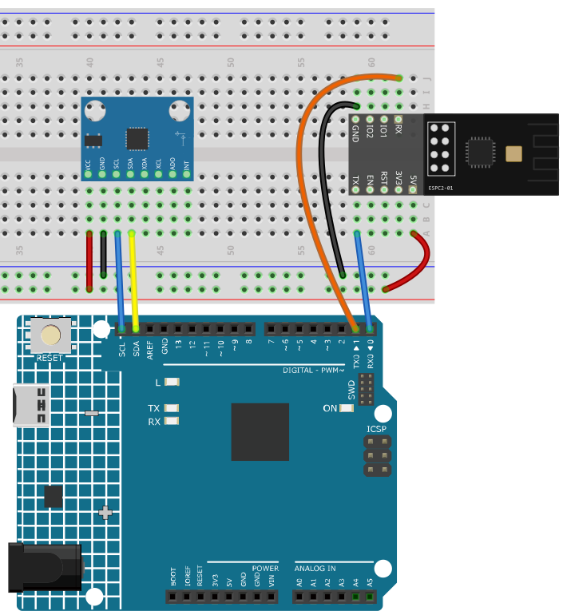

.. note::

    こんにちは、SunFounderのRaspberry Pi & Arduino & ESP32愛好家コミュニティへようこそ！Facebook上でRaspberry Pi、Arduino、ESP32についてもっと深く掘り下げ、他の愛好家と交流しましょう。

    **参加する理由は？**

    - **エキスパートサポート**：コミュニティやチームの助けを借りて、販売後の問題や技術的な課題を解決します。
    - **学び＆共有**：ヒントやチュートリアルを交換してスキルを向上させましょう。
    - **独占的なプレビュー**：新製品の発表や先行プレビューに早期アクセスしましょう。
    - **特別割引**：最新製品の独占割引をお楽しみください。
    - **祭りのプロモーションとギフト**：ギフトや祝日のプロモーションに参加しましょう。

    👉 私たちと一緒に探索し、創造する準備はできていますか？[|link_sf_facebook|]をクリックして今すぐ参加しましょう！

.. _c201_iot_Bluetooth_motion_monitor:

16. Bluetooth モーションモニター
=================================

この最後のプロジェクトは、唯一 **同時に双方向** で通信します。

* ボードが **MPU6050** の傾きをスマートフォンへ送ります - **C305** の Notification
  で、1 秒に 2 回。
* スマートフォンはその送信を **停止・再開** できます。**C304** に ``P`` か ``S`` を
  書き込みます。

ほかの章はどれも片方向だけでした。ここでは両方を見て、2 つの Characteristic の違い
がはっきり分かります。1 つはデータを **あなたへ** 運び、もう 1 つはあなたのコマンド
を **戻す** 方向に運びます。

1. 回路を組み立てる
-----------------------------

.. note::

   モジュールは起動時に大きな電流を引きます。9V 電池または外部電源を R4 Minima
   の DC ジャックに必ず接続してください。

* :ref:`cpn_uno`
* :ref:`cpn_espc201`
* :ref:`cpn_mpu6050`

2. コードを書き込む
-----------------------------

#. ``16-Bluetooth_motion_monitor.ino`` を ``ultimate-sensor-kit\code\iot_project_espc201\bluetooth\16-Bluetooth_motion_monitor`` から開きます。

   .. note::

      ライブラリマネージャーから **Adafruit MPU6050** と **Adafruit Unified Sensor**
      をインストールしてください。

#. **Arduino UNO R4 Minima** と正しいポートを選び、**Upload** をクリックします。

#. シリアルモニターを **115200** で開きます。次のように表示されます。

   .. code-block:: text

      === ESPC2-01 Bluetooth (BLE) ===
      [OK] BLE is ready - scan for "SunFounder-C2" on your phone
      --------------------------------
      [OK] MPU6050 is ready
      Keep the board flat and still - measuring the zero point ...
      zero: X=-1.0 Y=-3.0
      Send S on C304 to start, P to pause

   ``[!] no MPU6050 found`` と出たら、センサーが A4/A5 で応答していません。SDA、SCL、
   VCC、GND を確認してから先へ進んでください。

   .. note::

      **電源投入時はボードを平らに、動かさずに置いてください。** スケッチは最初の
      1 秒間に 10 回測り、その姿勢をゼロ点として記憶します。だから平らに置いたボード
      は、どのセンサーにもある数度のずれではなく ``X:0.0 Y:0.0`` を示します。``zero:``
      の行の 2 つの数値が、実際に測った値です。

3. 見ながら操作する
------------------------------

#. LightBlue を開き **Scan** をタップして **SunFounder-C2** に接続します。

#. サービス **0xA002** を展開し、Characteristic **C305** を開いて **Subscribe** を
   タップします。1 秒に 2 回、行が届きます。

   .. image:: ../img/ble_lightblue_subs.png
      :width: 80%

   .. code-block:: text

      X:1.2 Y:-0.4
      X:8.7 Y:-3.1

   **数値は度です。** ``0`` は平ら、``90`` は縦置き、符号はどちらに傾いているかを示
   します。

   .. list-table::
      :header-rows: 1
      :widths: 18 82

      * - 値
        - 内容
      * - ``X``
        - **X 軸まわり** の傾き - ボードが左右に傾く
      * - ``Y``
        - **Y 軸まわり** の傾き - ボードが前後に傾く

   .. note::

      垂直に近づくと 2 つの数値が少し影響し合います。``Y:80`` まで傾けると ``X`` も
      動き始めます。この角度の計算方法によるもので、配線の不具合ではありません。

#. サービス一覧に戻り **C304** を開きます。``P`` を書くと送信がすぐ止まり、シリアル
   モニターに ``Streaming paused`` と出ます。

   .. image:: ../img/ble_lightblue_write.png
      :width: 80%

   .. note::

      ここが面白いところです。**C305 の購読は開いたまま** なのに、何も届かなくなり
      ます。ボードが送るのをやめたからです。データはスケッチが送ると決めたときだけ流
      れます。

#. ``S`` を書くと再開し、行が戻ってきます。

4. コードの説明
-----------------------------

#. **1 つのループに 2 つの方向**

   .. code-block:: arduino

      while (bleSerial.available() > 0) {          // スマートフォン -> ボード
        char c = (char)bleSerial.read();
        if (c == 'S') streaming = true;
        else if (c == 'P') streaming = false;
      }

      if (streaming && millis() - lastSend > interval) {   // ボード -> スマートフォン
        bleSerial.println(line);
      }

   1 つ目のブロックが **読み**、2 つ目が **書きます**。どちらも同じ ``loop()`` で動
   き、互いを止めません - だからデータが流れている間も、スマートフォンはいつでもコマ
   ンドを送れます。

#. **生の加速度ではなく傾き**

   .. code-block:: arduino

      float tiltX = atan2(ay, az) * 180.0 / PI;
      float tiltY = atan2(-ax, sqrt(ay * ay + az * az)) * 180.0 / PI;

   センサーは ``m/s^2`` の加速度を返し、そのままでは読みにくい値です。``atan2`` が度
   の角度に変えます。``0`` が平ら、``90`` が縦置きです。

#. **ゼロ点**

   .. code-block:: arduino

      float sumX = 0, sumY = 0;
      for (int i = 0; i < 10; i++) {
        float tx, ty;
        readTilt(tx, ty);
        sumX += tx;
        sumY += ty;
        delay(50);
      }
      zeroX = sumX / 10.0;
      zeroY = sumY / 10.0;

   1 回の測定は 1〜2 度ばらつくので、10 回の平均を取ります。その平均を以後のすべて
   の測定から引きます。

   .. code-block:: arduino

      float x = tiltX - zeroX;
      float y = tiltY - zeroY;

   この処理がないと、平らに置いたボードが ``X:-1.0 Y:-3.0`` を示し、学習者は何か壊
   れたと思うでしょう。これがあれば ``0.0`` は本当に「平ら」です - 実際の製品も、ふ
   つうは再ゼロ合わせのボタンを付けて同じことをします。

#. **行と行の間は 0.5 秒**

   .. code-block:: arduino

      const unsigned long interval = 500;
      if (streaming && millis() - lastSend > interval) { ... }

   BLE は終わりのない連続送信には向きません。500ms に 1 行なら画面では滑らかで、し
   かもコマンド用の回線に余裕が残ります。ループごとに送るとバッファがあふれ、``P``
   の到着が遅れます。
