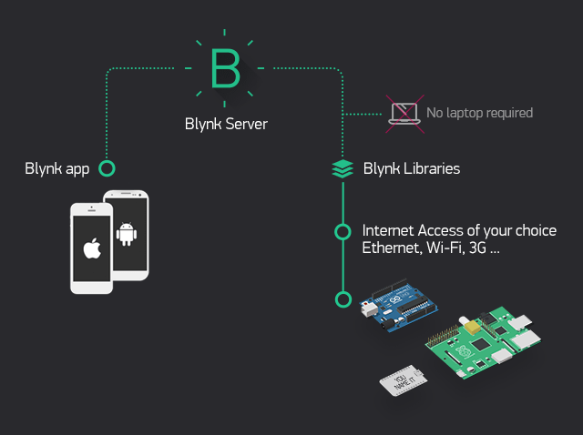

.. note::

    Hallo und willkommen in der SunFounder Raspberry Pi & Arduino & ESP32 Enthusiasten-Gemeinschaft auf Facebook! Tauchen Sie tiefer ein in die Welt von Raspberry Pi, Arduino und ESP32 mit anderen Enthusiasten.

    **Warum beitreten?**

    - **Expertenunterstützung**: Lösen Sie Nachverkaufsprobleme und technische Herausforderungen mit Hilfe unserer Gemeinschaft und unseres Teams.
    - **Lernen & Teilen**: Tauschen Sie Tipps und Anleitungen aus, um Ihre Fähigkeiten zu verbessern.
    - **Exklusive Vorschauen**: Erhalten Sie frühzeitigen Zugang zu neuen Produktankündigungen und exklusiven Einblicken.
    - **Spezialrabatte**: Genießen Sie exklusive Rabatte auf unsere neuesten Produkte.
    - **Festliche Aktionen und Gewinnspiele**: Nehmen Sie an Gewinnspielen und Feiertagsaktionen teil.

    👉 Sind Sie bereit, mit uns zu erkunden und zu erschaffen? Klicken Sie auf [|link_sf_facebook|] und treten Sie heute bei!

.. _c201_iot_blynk_start:

Erste Schritte mit Blynk
=============================

Blynk ist eine komplette Software-Suite, mit der Sie verbundene elektronische Geräte
prototypisch aufbauen, ausrollen und aus der Ferne verwalten können - vom eigenen
IoT-Projekt bis zu Millionen kommerzieller Produkte.
Mit Blynk verbinden Sie Ihre Hardware mit der Cloud und bauen ohne Programmieraufwand
iOS-, Android- und Web-Anwendungen, die Messwerte in Echtzeit und im Verlauf anzeigen,
Geräte von überall auf der Welt steuern und wichtige Benachrichtigungen verschicken.

.. toctree::
    :maxdepth: 1

    00-blynk_config
    00-install_libs
    00-connect_r4_blynk
