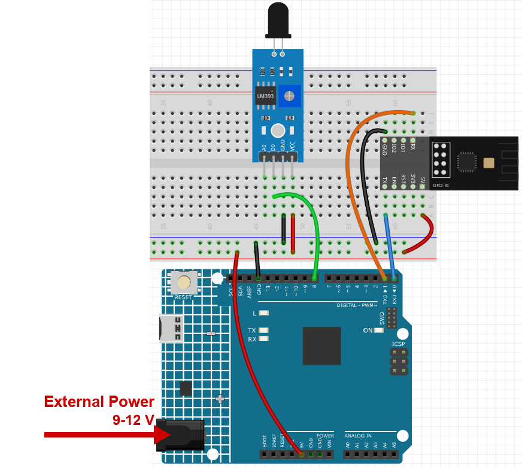

.. note::

    こんにちは、SunFounderのRaspberry Pi & Arduino & ESP32愛好家コミュニティへようこそ！Facebook上でRaspberry Pi、Arduino、ESP32についてもっと深く掘り下げ、他の愛好家と交流しましょう。

    **参加する理由は？**

    - **エキスパートサポート**：コミュニティやチームの助けを借りて、販売後の問題や技術的な課題を解決します。
    - **学び＆共有**：ヒントやチュートリアルを交換してスキルを向上させましょう。
    - **独占的なプレビュー**：新製品の発表や先行プレビューに早期アクセスしましょう。
    - **特別割引**：最新製品の独占割引をお楽しみください。
    - **祭りのプロモーションとギフト**：ギフトや祝日のプロモーションに参加しましょう。

    👉 私たちと一緒に探索し、創造する準備はできていますか？[|link_sf_facebook|]をクリックして今すぐ参加しましょう！

.. _c201_iot_Flame:

1. Blynk を使った炎警報システム
====================================

.. raw:: html

   <video loop autoplay muted style = "max-width:100%">
      <source src="../../_static/video/iot/01-iot_Flame_alert_system.mp4"  type="video/mp4">
      お使いのブラウザは video タグに対応していません。
   </video>

この章では、Blynk を使って家庭用の炎警報システムを作ります。炎センサーで火災の兆候
を検知し、その値を Blynk に送ることで、インターネット経由で自宅を遠隔監視できます。
火災が発生した場合は、Blynk がすぐにメールで知らせます。

1. 回路を組み立てる
-----------------------------

.. note::

    モジュールは起動時に大きな電流を引きます。9V 電池または外部電源を R4 Minima
    の DC ジャックに必ず接続してください。

* :ref:`cpn_uno`
* :ref:`cpn_flame`
* :ref:`cpn_espc201`

2. Blynk を設定する
-----------------------------

.. note::

    **テンプレート** と **デバイス** は :ref:`c201_iot_blynk_start` で作成済みです。
    テンプレートにデータを追加してもデバイスのトークンは **変わりません** ので、
    スケッチの 3 行はどのプロジェクトでも同じです。

**データストリームを追加する**

#. 入門章で作成したテンプレート **Ultimate Sensor Kit** を開きます。

   .. image:: ../img/blynk_template.png
      :width: 80%

#. **Edit** をクリックしてテンプレートを開きます。

   .. image:: ../img/blynk_edit.png
      :width: 80%

#. **Datastreams** をクリックし、**Create New** を選びます。

   .. image:: ../img/blynk_new_data.png
      :width: 80%

#. フォームを次のように入力します。

   * **DATASTREAM NAME**: ``flame_sensor_value``
   * **DISPLAY NAME**: ``Flame Sensor Value``
   * **VIRTUAL PIN**: ``V0``
   * **DATA TYPE**: **Integer**
   * **MIN** ``0``, **MAX** ``1``

   .. image:: ../img/blynk_flame_datastream.png
      :width: 80%

**イベントを追加する**

イベントは、スマートフォンに通知を出す仕組みです。

#. **Events & notifications** に切り替え、**Create Event** をクリックします。

   .. image:: ../img/blynk_new_event.png
      :width: 80%

#. **EVENT CODE** を ``flame_detected`` にします。

   .. note::

      このとおりに正確に入力してください。スケッチは
      ``Blynk.logEvent("flame_detected")`` を呼び出すので、つづりが違うと通知は届き
      ません。

   .. image:: ../img/blynk_flame_event.png
      :width: 80%

#. 通知を有効にし、送信先を選びます。

   .. image:: ../img/blynk_flame_event_notify.png
      :width: 80%

**Web ダッシュボードを追加する**

#. **Dashboard** をクリックし、**Add Widget** を選びます。

   .. image:: ../img/blynk_dashboard.png
      :width: 80%

#. **Label** ウィジェットをダッシュボードにドラッグします。

   .. image:: ../img/blynk_dashboard_label.png
      :width: 80%

#. ウィジェット右上の三点メニューから **Settings** を選びます。

   .. image:: ../img/blynk_label_setting.png
      :width: 80%

#. **Datastream** を ``Flame Sensor Value (V0)`` に設定します。

   .. image:: ../img/blynk_flame_label.png
      :width: 80%

#. **Save** をクリックします。

   .. image:: ../img/blynk_save.png
      :width: 40%

3. コードを実行する
-----------------------------

#. ``01-Flame_alert_system.ino`` を ``ultimate-sensor-kit\code\iot_project_espc201\wifi\01-Flame_alert_system`` から開くか、コードを **Arduino IDE** にコピーします。

#. Blynk の 3 行は :ref:`c201_iot_blynk_start` でコピー済みです。このキットのどの
   プロジェクトも同じデバイスを使うため、変更は不要です - 変えるのは下の Wi-Fi 設定
   だけです。

   .. code-block:: arduino

      #define BLYNK_TEMPLATE_ID   "TMPLxxxxxx"
      #define BLYNK_TEMPLATE_NAME "Ultimate Sensor Kit"
      #define BLYNK_AUTH_TOKEN    "YourAuthToken"

#. 使用する Wi-Fi の ``ssid`` と ``password`` も入力します。

   .. code-block:: arduino

    char ssid[] = "your_ssid";
    char pass[] = "your_password";

#. 正しいボードとポートを選んで **Upload** をクリックします。シリアルモニターを
   開き（ボーレート **115200**）、接続成功のようなメッセージが出るまで待ちます。

   .. image:: ../img/blynk_flame_serial.png
      :width: 80%

#. Blynk に炎センサーの値が表示されます。ラベルウィジェットに読み取り値が出ます。
   値が **1** のときラベルの背景は緑、**0** のときは赤になり、Blynk から警告メールが
   届きます。

   .. image:: ../img/blynk_flame_dashboard.png
      :width: 70%

#. スマートフォンで Blynk を使いたい場合は :ref:`blynk_mobile` を参照してください。

4. コードの説明
-----------------------------

1. **Blynk アカウントとライブラリ**

   最初の 3 行は、このボードがどの Blynk デバイスに属するかを示します。入門章でコ
   ピーしたもので、このキットのどのプロジェクトでも同じです。

   .. code-block:: arduino

      #define BLYNK_TEMPLATE_ID   "TMPL2Ms3WVki8"
      #define BLYNK_TEMPLATE_NAME "Ultimate Sensor Kit"
      #define BLYNK_AUTH_TOKEN    "lHSd4Q5pXP7YKUovVfPZYZqC0UHVORY6"

      #define BLYNK_PRINT Serial             // シリアルモニターにデバッグ出力

      #include <ESP8266_Lib.h>               // AT コマンドのドライバー
      #include <BlynkSimpleShieldEsp8266.h>  // そのドライバー上で動く Blynk

2. **モジュールと通信するシリアルポート**

   ESPC2-01 はスケッチを実行しているのではなく、AT コマンドを受け取るモデムとして
   動作します。R4 では D0/D1、つまり ``Serial1`` につながっています。ハードウェア
   シリアルなので、115200 でもビット化けはありません。

   .. code-block:: arduino

      #define EspSerial Serial1
      #define ESP8266_BAUD 115200
      ESP8266 wifi(&EspSerial);

3. **Wi-Fi 認証情報、センサーピン、タイマー**

   .. code-block:: arduino

      char ssid[] = "MakerStarsHall";
      char pass[] = "sunfounder";

      const int sensorPin = 8;
      BlynkTimer timer;

   炎モジュールはデジタルのレベルを出力するので、ピン 8 は ``digitalRead()`` で読み
   ます。``BlynkTimer`` は Blynk ライブラリのソフトウェアタイマーで、``delay()`` を
   使わずに関数を定期的に呼び出します。``delay()`` は接続を止めてしまうからです。

4. **espModuleInit() - まずモジュールを起こす**

   モジュールは起動に約 1 秒かかり、その起動ログを同じ回線に出力します。スケッチが
   早すぎるタイミングで AT コマンドを送ると、応答がそのログと混ざり、Blynk が読めな
   くなります。この関数は ``ready`` という語を待ち、その後 ``ATE0`` でエコーを切り
   ます。

   .. code-block:: arduino

      void espModuleInit() {
        unsigned long t0 = millis();
        String buf;
        while (millis() - t0 < 5000) {
          while (EspSerial.available()) {
            buf += (char)EspSerial.read();
            if (buf.indexOf("ready") >= 0) t0 = millis() - 5000;   // ループを抜ける
          }
        }
        while (EspSerial.available()) EspSerial.read();
        EspSerial.print("ATE0\r\n");   // エコーオフ
        delay(300);
        while (EspSerial.available()) EspSerial.read();
      }

   ``ATE0`` は必須です。エコーが有効だと、すべての応答が直前に送ったコマンドで始ま
   り、Blynk のパーサーは本当の応答の前にゴミの行を見てしまいます。

5. **setup()**

   .. code-block:: arduino

      void setup() {
        pinMode(sensorPin, INPUT);

        Serial.begin(115200);           // シリアルモニター
        EspSerial.begin(ESP8266_BAUD);  // モジュール
        delay(1000);

        timer.setInterval(1000L, myTimerEvent);   // 1 秒に 1 回

        espModuleInit();
        Blynk.config(wifi, BLYNK_AUTH_TOKEN);
        Blynk.connectWiFi(ssid, pass);
      }

   * ``timer.setInterval(1000L, myTimerEvent)`` は関数を 1000ms ごとに呼びます。数値
     を変えれば、報告の間隔を速くも遅くもできます。
   * ``Blynk.config()`` はトークンを記憶し、``Blynk.connectWiFi()`` がモジュールを
     オンラインにします。``Blynk.begin(...)`` の 1 行でも書けますが、2 段階にすると
     モジュールの起動を先に済ませられます。

6. **loop()**

   .. code-block:: arduino

      void loop() {
        Blynk.run();
        timer.run();
      }

   ``Blynk.run()`` が接続を保ち、``timer.run()`` が予定した関数を実行します。ループ
   内でブロックする処理があってはいけません。プラットフォームがデバイスを切断します。

7. **sendData() - ピンを読んで報告する**

   .. code-block:: arduino

      void sendData() {
        int data = digitalRead(sensorPin);
        Blynk.virtualWrite(V0, data);
        Serial.print("flame:");
        Serial.println(data);
        if (data == 0) {
          Blynk.logEvent("flame_detected");
        }
      }

   * ``Blynk.virtualWrite(V0, data)`` はデータストリーム **V0** に値を送ります。
     ダッシュボードのラベルがこれを表示します。
   * 炎モジュールは **アクティブロー** です。炎が近いと ``0``、空気がきれいなら
     ``1`` を返します。だから ``data == 0`` を判定しています。
   * ``Blynk.logEvent("flame_detected")`` が通知を出すイベントを送ります。文字列は
     先に作成した **EVENT CODE** と 1 文字も違わず一致している必要があります。
