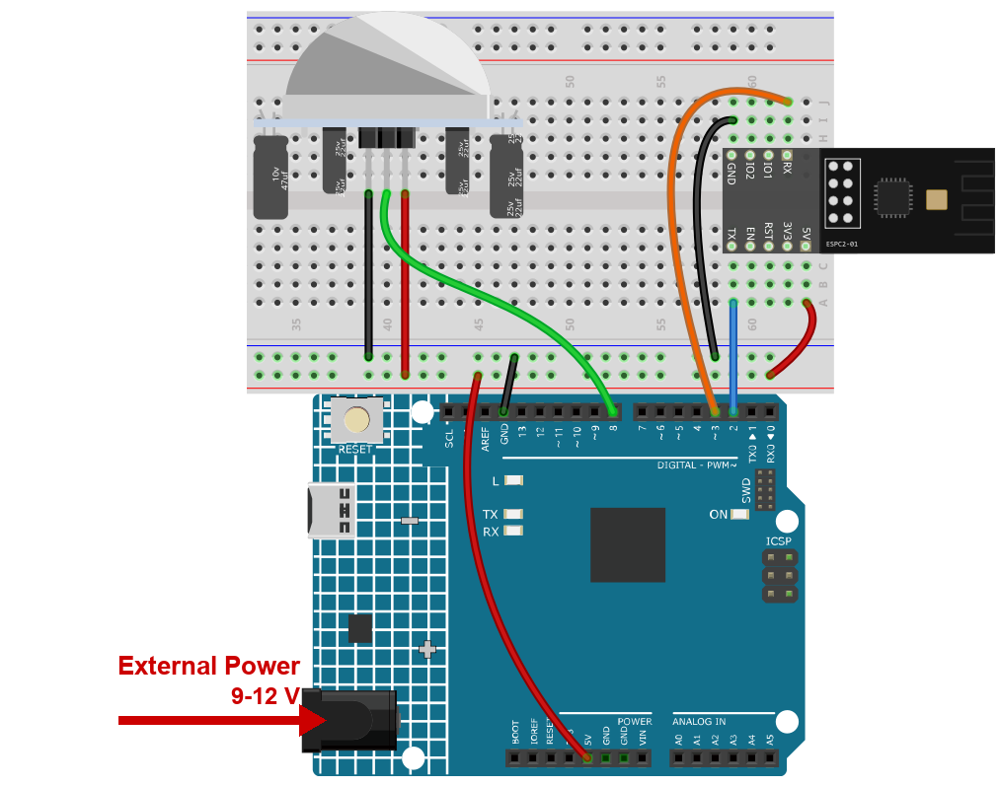

.. note::

    こんにちは、SunFounderのRaspberry Pi & Arduino & ESP32愛好家コミュニティへようこそ！Facebook上でRaspberry Pi、Arduino、ESP32についてもっと深く掘り下げ、他の愛好家と交流しましょう。

    **参加する理由は？**

    - **エキスパートサポート**：コミュニティやチームの助けを借りて、販売後の問題や技術的な課題を解決します。
    - **学び＆共有**：ヒントやチュートリアルを交換してスキルを向上させましょう。
    - **独占的なプレビュー**：新製品の発表や先行プレビューに早期アクセスしましょう。
    - **特別割引**：最新製品の独占割引をお楽しみください。
    - **祭りのプロモーションとギフト**：ギフトや祝日のプロモーションに参加しましょう。

    👉 私たちと一緒に探索し、創造する準備はできていますか？[|link_sf_facebook|]をクリックして今すぐ参加しましょう！

.. _c201_iot_Intrusion_alert_system:

2. Blynk を使った侵入警報システム
========================================

.. raw:: html

   <video loop autoplay muted style = "max-width:100%">
      <source src="../../_static/video/iot/02-iot_Intrusion_alert_system.mp4
       "  type="video/mp4">
      お使いのブラウザは video タグに対応していません。
   </video>

このプロジェクトは、焦電型赤外線（PIR）センサー（HC-SR501）を使った簡単な侵入検知
システムです。Blynk アプリで **Away** モードにすると、PIR センサーが動きを監視します。
動きを検知すると Blynk アプリに通知が出て、侵入の可能性を知らせます。

1. 回路を組み立てる
-----------------------------

.. note::

    モジュールは起動時に大きな電流を引きます。9V 電池または外部電源を R4 Minima
    の DC ジャックに必ず接続してください。

* :ref:`cpn_uno`
* :ref:`cpn_espc201`
* :ref:`cpn_pir_motion`

2. Blynk を設定する
-----------------------------

.. note::

    テンプレートとデバイスは :ref:`c201_iot_blynk_start` で一度作成済みです。どのプ
    ロジェクトも **同じ** テンプレートにデータストリームを追加するので、プロジェクト
    ごとに仮想ピンの範囲が分かれます。このプロジェクトは **V1** と **V2** を使います。
    デバイスのトークンは変わらないので、スケッチはそのまま動きます。

**クラウドに伝えるのは 2 つ、うち 1 つはデータストリームが 2 本必要です。**

* ``away_mode`` - 外出時に切り替えるスイッチ。
* ``current_status`` - ボードが書き戻すテキスト。今何をしているか分かります。

**データストリームを追加する**

#. **Developer Zone** -> **My Templates** を開き、**Ultimate Sensor Kit** をクリック
   します。

   .. image:: ../img/blynk_template.png
      :width: 80%

#. **Edit** をクリックしてテンプレートを開きます。

   .. image:: ../img/blynk_edit.png
      :width: 80%

#. **Datastreams** をクリックし、**Create New** を選びます。

   .. image:: ../img/blynk_new_data.png
      :width: 80%

#. 1 本目のデータストリームを作ります。

   * **DATASTREAM NAME**: ``away_mode``
   * **DISPLAY NAME**: ``Away Mode``
   * **VIRTUAL PIN**: ``V1``
   * **DATA TYPE**: **Integer**
   * **MIN** ``0``, **MAX** ``1``

   .. note::

      範囲 0〜1 の Integer は、スイッチを表すときの定番です。``1`` が警報 ON、``0``
      が OFF です。

   .. image:: ../img/blynk_intrusion_dataset.png
      :width: 80%

#. もう一度 **Create New** をクリックして、2 本目を作ります。

   * **DATASTREAM NAME**: ``current_status``
   * **DISPLAY NAME**: ``Current Status``
   * **VIRTUAL PIN**: ``V2``
   * **DATA TYPE**: **String**

   .. note::

      **String** はテキストを保持します。ボードは ``Detecting signs of intrusion...``
      や ``Somebody in your house!`` のような行を送り、Label ウィジェットがそのまま表
      示できます。

   .. image:: ../img/blynk_intrusion_v2set.png
      :width: 80%

#. 一覧に 2 本とも表示されます。

   .. image:: ../img/blynk_intrusion_2data.png
      :width: 80%

**イベントを追加する**

イベントは、センサーの値からスマートフォンの通知を作る仕組みです。これがないと、
警報はラベルを変えるだけで、誰も気づきません。

#. **Events & notifications** を開き、**Create Event** をクリックします。

   .. image:: ../img/blynk_intrusion_new_events.png
      :width: 80%

#. **EVENT CODE** を ``intrusion_detected`` にします。

   .. note::

      このとおりに正確に入力してください。スケッチは
      ``Blynk.logEvent("intrusion_detected")`` を呼び出し、つづりが違うと何も起きませ
      ん。

   .. image:: ../img/blynk_intrusion_event_code.png
      :width: 80%

#. 通知を有効にし、送信先を選びます。

   .. image:: ../img/blynk_intrusion_event_noti.png
      :width: 80%

**Web ダッシュボードを追加する**

ダッシュボードは、あなたが見る画面です。ここでは 2 つのウィジェットで足ります。

#. **Dashboard** をクリックし、**Add Widget** を選びます。

   .. image:: ../img/blynk_dashboard.png
      :width: 80%

#. **Label** ウィジェットをダッシュボードにドラッグします。

   .. image:: ../img/blynk_dashboard_label.png
      :width: 80%

#. **Switch** ウィジェットを追加します。

   .. image:: ../img/blynk_intrusion_switch.png
      :width: 80%

#. **Label** の右上の三点メニューから **Settings** を選びます。

   * **Datastream** を ``Current Status (V2)`` に設定します。

   .. image:: ../img/blynk_intrusion_label_set.png
      :width: 80%

#. **Switch** も同じように設定します。

   * **Datastream** を ``Away Mode (V1)``、**ON LABEL** を ``away home``、
     **OFF LABEL** を ``at home`` にします。

   .. image:: ../img/blynk_intrusion_switch_set.png
      :width: 80%

#. **Save** をクリックします。

   .. image:: ../img/blynk_save.png
      :width: 40%

3. コードを実行する
-----------------------------

#. ``02-Intrusion_alert_system.ino`` を ``ultimate-sensor-kit\code\iot_project_espc201\wifi\02-Intrusion_alert_system`` から開くか、コードを **Arduino IDE** にコピーします。

#. Blynk の 3 行は入門章でコピーしたものです。そのままにしてください - デバイスは作
   成済みなので、プロジェクト間で違うのは Wi-Fi 設定だけです。

   .. code-block:: arduino

      #define BLYNK_TEMPLATE_ID   "TMPLxxxxxx"
      #define BLYNK_TEMPLATE_NAME "Ultimate Sensor Kit"
      #define BLYNK_AUTH_TOKEN    "YourAuthToken"

#. 自分の Wi-Fi ネットワークの名前とパスワードを入力します。

   .. code-block:: arduino

      char ssid[] = "your_ssid";
      char pass[] = "your_password";

#. **Arduino UNO R4 Minima** と正しいポートを選び、**Upload** をクリックします。

#. シリアルモニターを **115200** で開きます。ボードがクラウドに到達すると、ログの
   最後が ``Ready`` になります。アプリでスイッチを切り替えるたびにここに 1 行出るの
   で、両者が通信していることが分かります。

   .. image:: ../img/blynk_flame_serial.png
      :width: 80%

#. スイッチを **away home** にし、PIR センサーの前で手を振ってみてください。ダッシュ
   ボードのラベルが ``Somebody in your house! Please check!`` に変わり、スマート
   フォンに通知が出ます。

   .. image:: ../img/blynk_intrusion_dashboard.png
      :width: 80%

#. スマートフォンで Blynk を使う場合は :ref:`blynk_mobile` を参照してください。

4. コードの説明
-----------------------------

#. **Blynk アカウントとライブラリ**

   最初の 3 行は、このボードがどの Blynk デバイスに属するかを示します。デバイス
   ページの内容で、このキットのどのプロジェクトでも同じです。

   .. code-block:: arduino

      #define BLYNK_TEMPLATE_ID   "TMPL2Ms3WVki8"
      #define BLYNK_TEMPLATE_NAME "Ultimate Sensor Kit"
      #define BLYNK_AUTH_TOKEN    "lHSd4Q5pXP7YKUovVfPZYZqC0UHVORY6"

      #define BLYNK_PRINT Serial   // Blynk のログをシリアルモニターに出す

      #include <ESP8266_Lib.h>               // AT コマンドを送る
      #include <BlynkSimpleShieldEsp8266.h>  // その上で動く Blynk

#. **モジュールと通信するシリアルポート**

   ESPC2-01 はスケッチを実行しておらず、AT コマンドに応答するモデムとして動作しま
   す。R4 では D0/D1、つまり ``Serial1`` につながっており、ハードウェアポートなの
   で 115200 でもビット化けしません。

   .. code-block:: arduino

      #define EspSerial Serial1
      #define ESP8266_BAUD 115200
      ESP8266 wifi(&EspSerial);

#. **PIR のピンと 2 つの状態変数**

   .. code-block:: arduino

      const int sensorPin = 8;   // PIR 出力: HIGH = 動きあり、LOW = 静か

      int state = 0;           // 直前に読んだピンの値
      int awayHomeMode = 0;    // 1 = アプリのスイッチが ON で警報が有効

      BlynkTimer timer;

   ``state`` があることで次の節が可能になります。新しい値と前の値を比べれば、誰か
   が通った瞬間が分かります。「人がいる」を何百回も送る代わりです。``awayHomeMode``
   は「在宅かどうか」の答えで、``1`` のときだけ警報が反応します。

#. **espModuleInit() - まずモジュールを起こす**

   モジュールは起動に約 1 秒かかり、その起動ログをこれから使う回線に出力します。
   早すぎるコマンドはログと混ざります。この関数は ``ready`` を待ってから ``ATE0``
   を送ります。

   .. code-block:: arduino

      void espModuleInit() {
        unsigned long t0 = millis();
        String buf;
        while (millis() - t0 < 5000) {
          while (EspSerial.available()) {
            buf += (char)EspSerial.read();
            if (buf.indexOf("ready") >= 0) t0 = millis() - 5000;   // ループを抜ける
          }
        }
        while (EspSerial.available()) EspSerial.read();
        EspSerial.print("ATE0\r\n");   // エコーオフ
        delay(300);
        while (EspSerial.available()) EspSerial.read();
      }

   ``ATE0`` でエコーを切ります。エコーが有効だと、応答が直前に送ったコマンドで始ま
   り、Blynk はその行をゴミとして読みます。

#. **setup()**

   .. code-block:: arduino

      void setup() {
        pinMode(sensorPin, INPUT);

        Serial.begin(115200);
        EspSerial.begin(ESP8266_BAUD);
        delay(10);

        espModuleInit();
        Blynk.config(wifi, BLYNK_AUTH_TOKEN);
        Blynk.connectWiFi(ssid, pass);

        timer.setInterval(1000L, myTimerEvent);
      }

   ``timer.setInterval(1000L, myTimerEvent)`` は関数を 1 秒に 1 回呼びます。数値を変
   えればセンサーの確認頻度を変えられます。

#. **loop()**

   .. code-block:: arduino

      void loop() {
        Blynk.run();
        timer.run();
      }

   ``Blynk.run()`` が接続を保ち、``timer.run()`` が予定した関数を実行します。ここで
   ブロックしてはいけません。クラウドがデバイスを切断します。

#. **BLYNK_CONNECTED() と BLYNK_WRITE(V1)**

   .. code-block:: arduino

      BLYNK_CONNECTED() {
        Blynk.syncVirtual(V1);
      }

      BLYNK_WRITE(V1) {
        awayHomeMode = param.asInt();
        ...
      }

   ``BLYNK_CONNECTED()`` はボードがサーバーに到達するたびに実行されます。停電の後
   もです。``Blynk.syncVirtual(V1)`` が現在のスイッチ位置を問い合わせるので、真夜中
   に再起動したボードでも、あなたが外出したことを覚えています。

   ``BLYNK_WRITE(V1)`` はアプリのスイッチが動くたびに実行されます。
   ``param.asInt()`` が新しい値（``1`` か ``0``）で、応答はそのままデータストリー
   ム **V2** のラベルに返ります。

#. **sendData() - レベルではなくエッジに反応する**

   .. code-block:: arduino

      void sendData() {
        int now = digitalRead(sensorPin);
        bool rising = (now == HIGH && state == LOW);
        state = now;

        if (awayHomeMode == 1 && rising && millis() - lastAlert > 5000) {
          lastAlert = millis();
          Blynk.virtualWrite(V2, "Somebody in your house! Please check!");
          Blynk.logEvent("intrusion_detected");
        }
      }

   * ``rising`` は ``LOW`` から ``HIGH`` への変化の瞬間だけ真になります。センサーが
     反応したその瞬間です。これがないと、誰かが立っている間ずっと 1 秒ごとにメッ
     セージを送り、Blynk の無料枠を数分で使い切ります。
   * ``millis() - lastAlert > 5000`` で 2 つの警告は最低 5 秒離れます。
   * ``Blynk.virtualWrite(V2, ...)`` がラベルに表示するテキストを書き込みます。
   * ``Blynk.logEvent("intrusion_detected")`` が通知を出すイベントを送ります。名前
     は作成した **EVENT CODE** と 1 文字も違わず一致している必要があります。
