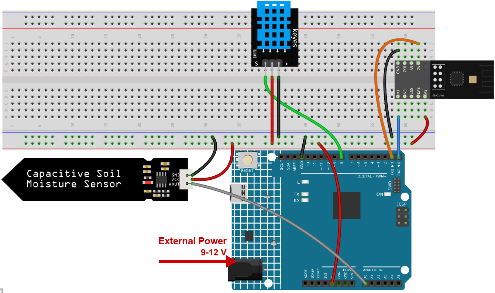
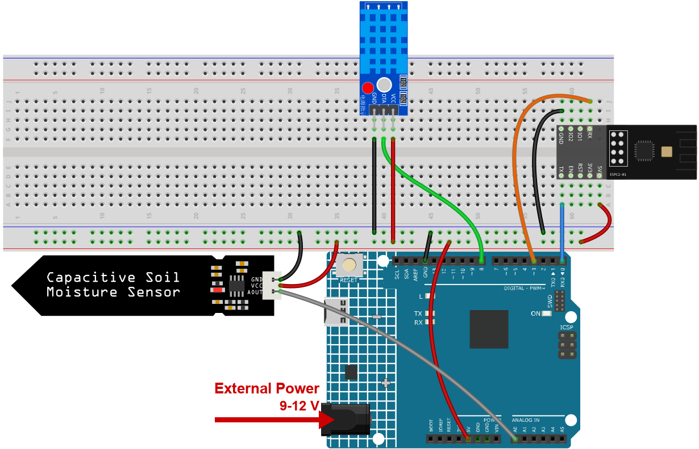

.. note::

    Hello, welcome to the SunFounder Raspberry Pi & Arduino & ESP32 Enthusiasts Community on Facebook! Dive deeper into Raspberry Pi, Arduino, and ESP32 with fellow enthusiasts.

    **Why Join?**

    - **Expert Support**: Solve post-sale issues and technical challenges with help from our community and team.
    - **Learn & Share**: Exchange tips and tutorials to enhance your skills.
    - **Exclusive Previews**: Get early access to new product announcements and sneak peeks.
    - **Special Discounts**: Enjoy exclusive discounts on our newest products.
    - **Festive Promotions and Giveaways**: Take part in giveaways and holiday promotions.

    👉 Ready to explore and create with us? Click [|link_sf_facebook|] and join today!

.. _c201_iot_Plant_monitor:

3. Plant Monitor with Blynk
=============================

.. raw:: html

   <video loop autoplay muted style = "max-width:100%">
      <source src="../../_static/video/iot/03-iot_Plant_monitor.mp4"  type="video/mp4">
      Your browser does not support the video tag.
   </video>

This project creates a plant monitoring demo system that detects the current temperature, humidity, light intensity, and soil moisture. The data is then displayed on Blynk along with suggestions based on the soil moisture levels.

1. Build the Circuit
-----------------------------

.. note::

   The module draws a high current at start-up, so make sure the 9 V battery or an external power supply is plugged into the DC jack of the R4 Minima.

   **The kit may contain different versions of the DHT11 module. Please confirm the wiring method according to the module you have.**

* :ref:`cpn_uno`
* :ref:`cpn_espc201`
* :ref:`cpn_dht11`
* :ref:`cpn_soil`

2. Configure Blynk
-----------------------------

.. note::

    The template and the device were created once in :ref:`c201_iot_blynk_start`.
    Every project adds its datastreams to that **same** template, so each project
    occupies its own range of virtual pins. This project uses **V3** to **V6**.

**What this project sends to the cloud**

Four values, and the type of each one matters - it decides how Blynk can display it:

* ``temperature`` - a decimal number, so **Double**.
* ``humidity`` - a decimal number, so **Double**.
* ``soil_moisture`` - a word such as ``dry`` / ``wet``, so **String**.
* ``led_status`` - brightness 0..255 for the lamp on the dashboard, so **Integer**. The
  sketch always sends 255 and only the colour changes.

**Add the datastreams**

#. Open **Developer Zone** -> **My Templates**, click **Ultimate Sensor Kit**.

   .. image:: ../img/blynk_template.png
      :width: 80%

#. Click **Edit** to open the template.

   .. image:: ../img/blynk_edit.png
      :width: 80%
      

#. Click **Datastreams**, then **Create New**.

   .. image:: ../img/blynk_new_data.png
      :width: 80%

#. Create the first datastream:

   * **DATASTREAM NAME**: ``temperature``
   * **DISPLAY NAME**: ``Temperature``
   * **VIRTUAL PIN**: ``V3``
   * **DATA TYPE**: **Integer**
   * **MIN** ``-100``, **MAX** ``100``

   .. image:: ../img/blynk_plant_data_tem.png
      :width: 80%

#. Set the **UNITS** field to ``Celsius``.

   .. image:: ../img/blynk_plant_data_unit.png
      :width: 80%

#. Create the other three datastreams the same way, with these values:

   .. list-table::
      :header-rows: 1
      :widths: 12 26 14 20 28

      * - Pin
        - Name
        - Type
        - Min / Max
        - Units
      * - V4
        - ``humidity``
        - Double
        - 0 / 100
        - Percent
      * - V5
        - ``soil_moisture``
        - String
        - -
        - -
      * - V6
        - ``led_status``
        - Integer
        - 0 / 255
        - -

   .. image:: ../img/blynk_plant_datastreams.png
      :width: 80%

**Add the web dashboard**

#. Click **Dashboard**, then **Add Widget**.

   .. image:: ../img/blynk_dashboard.png
      :width: 80%

#. Drag a **Gauge** widget onto the dashboard.

   .. image:: ../img/blynk_dashboard_gauge.png
      :width: 80%

#. Click the three dots in the corner of the **Gauge** and choose **Settings**. 

   * Set **Datastream** to ``Temperature (V3)``.

   .. image:: ../img/blynk_plant_gauge_set.png
      :width: 80%   

#. Drag the other widgets onto the dashboard the same way - one more **Gauge**, one **Label** and one **LED** - then bind them:

   .. list-table::
      :header-rows: 1
      :widths: 26 40 34

      * - Widget
        - Datastream
        - What it shows
      * - Gauge
        - ``Humidity (V4)``
        - how damp the air is
      * - Label
        - ``Soil Moisture (V5)``
        - ``dry`` or ``wet``
      * - LED
        - ``Led Status (V6)``
        - a status lamp on the dashboard: green when the soil is fine, red when it is not

   .. image:: ../img/blynk_plant_widgets.png
      :width: 80%

   .. note::

      The **LED** widget is a **lamp on the dashboard**. The
      sketch always writes ``255`` for full brightness and only changes the colour: green
      when the soil moisture is in the right range, red when it is too wet or too dry.
      So you can read the state of the plant from across the room.

#. Click **Save**.

   .. image:: ../img/blynk_save.png
      :width: 40%

3. Run the Code
-----------------------------

#. Open the ``03-Plant_monitor.ino`` file under the path of ``ultimate-sensor-kit\code\iot_project_espc201\wifi\03-Plant_monitor``, or copy this code into **Arduino IDE**.

#. The three Blynk lines were copied in :ref:`c201_iot_blynk_start`. Every project of
   this kit uses the same device, so they never have to be changed - only the Wi-Fi
   settings below are project specific.

   .. code-block:: arduino

      #define BLYNK_TEMPLATE_ID   "TMPLxxxxxx"
      #define BLYNK_TEMPLATE_NAME "Ultimate Sensor Kit"
      #define BLYNK_AUTH_TOKEN    "YourAuthToken"

#. You also need to enter the ``ssid`` and ``password`` of the WiFi you are using. 

   .. code-block:: arduino

    char ssid[] = "your_ssid";
    char pass[] = "your_password";

#. After selecting the correct board and port, click the **Upload** button.

#. Open the Serial monitor(set baudrate to 115200) and wait for a prompt such as a successful connection to appear.

   .. image:: ../img/blynk_plant_serial.png
      :width: 80%

#. You will also see the same values on the Blynk dashboard.

   .. image:: ../img/blynk_plant_dashboard.png
      :width: 80%

4. Code explanation
-----------------------------

#. **Blynk account and libraries**

   The first three lines say which Blynk device this board belongs to. They come from the
   device page and are identical in every project of this kit.

   .. code-block:: arduino

      #define BLYNK_TEMPLATE_ID   "TMPL2Ms3WVki8"
      #define BLYNK_TEMPLATE_NAME "Ultimate Sensor Kit"
      #define BLYNK_AUTH_TOKEN    "lHSd4Q5pXP7YKUovVfPZYZqC0UHVORY6"

      #define BLYNK_PRINT Serial   // show Blynk's own log on the Serial Monitor

      #include <ESP8266_Lib.h>               // sends the AT commands
      #include <BlynkSimpleShieldEsp8266.h>  // Blynk on top of them

#. **The serial port that talks to the module**

   The ESPC2-01 works as a modem: the sketch sends it AT commands. On the R4 it is wired
   to D0/D1, which is ``Serial1``, a hardware port, so 115200 works without bit errors.

   .. code-block:: arduino

      #define EspSerial Serial1
      #define ESP8266_BAUD 115200
      ESP8266 wifi(&EspSerial);

   The function ``espModuleInit()`` waits for the module to finish booting and then sends
   ``ATE0`` to switch the echo off. Without it the module's start-up log and the echoed
   commands end up mixed with the replies, and Blynk cannot read them.

#. **The DHT11 sensor**

   .. code-block:: arduino

      #include <DHT.h>
      #define DHTPIN 8
      #define DHTTYPE DHT11
      DHT dht(DHTPIN, DHTTYPE);

      float temperature;
      float humidity;

   A DHT11 returns whole degrees and whole percent, so a ``float`` is more precision than
   the sensor really has - but it keeps the code simple and the same for a DHT22 later.

#. **The soil moisture sensor and the two thresholds**

   .. code-block:: arduino

      #define wetSoil 320
      #define drySoil 400

      const int moistureSensorPin = A0;
      int moisture;
      String soilStatus;

   The probe returns an analogue value between 0 and 1023, and **the wetter the soil, the
   lower the number**. That is why the sketch says "below ``wetSoil`` = too wet".

   .. note::

      Measure the two numbers yourself. Push the probe into a glass of water and read the
      value: that is roughly your ``wetSoil``. Then read it in dry soil: that is
      ``drySoil``. The defaults 320 / 400 only fit the soil of the developer.

#. **setup()**

   .. code-block:: arduino

      void setup() {
        Serial.begin(115200);
        EspSerial.begin(ESP8266_BAUD);
        delay(10);

        espModuleInit();
        Blynk.config(wifi, BLYNK_AUTH_TOKEN);
        Blynk.connectWiFi(ssid, pass);

        timer.setInterval(5000L, myTimerEvent);

        dht.begin();
      }

   ``timer.setInterval(5000L, myTimerEvent)`` measures once every five seconds. A DHT11
   cannot do better than one reading per second anyway, and plants do not change faster
   than that.

#. **loop()**

   .. code-block:: arduino

      void loop() {
        Blynk.run();
        timer.run();
      }

   ``Blynk.run()`` keeps the connection alive, ``timer.run()`` fires the measurement.
   Nothing here may block, or the cloud drops the device.

#. **sendData() - measure, judge, report**

   .. code-block:: arduino

      void sendData() {
        humidity = dht.readHumidity();
        temperature = dht.readTemperature();

        if (isnan(humidity) || isnan(temperature)) {
          Serial.println(F("Failed to read from DHT sensor!"));
          return;                                  // skip this round
        }

        moisture = analogRead(moistureSensorPin);

        String color;
        if (moisture < wetSoil) {
          soilStatus = "Soil is too wet";
          color = "#D3435C";
        } else if (moisture >= wetSoil && moisture < drySoil) {
          soilStatus = "Soil moisture is perfect";
          color = "#00FF00";
        } else {
          soilStatus = "Soil is too dry - time to water!";
          color = "#D3435C";
        }

        Blynk.virtualWrite(V3, temperature);
        Blynk.virtualWrite(V4, humidity);
        Blynk.virtualWrite(V5, soilStatus);
        Blynk.virtualWrite(V6, 255);
        Blynk.setProperty(V6, "color", color);
      }

   * ``return`` on a failed DHT reading leaves the dashboard showing the last good value
     instead of overwriting it with ``nan``.
   * ``Blynk.virtualWrite(V3, ...)`` and friends push the four values to the datastreams.
   * ``Blynk.virtualWrite(V6, 255)`` turns the **LED widget on the dashboard** fully on;
     ``Blynk.setProperty(V6, "color", color)`` then paints it green or red. The real LED
     marked **L** on the board is not used by this project.

#. **printData()**

   .. code-block:: arduino

      void printData() {
        Serial.print(F("Humidity: "));
        Serial.print(humidity);
        Serial.print(F("%  Temperature: "));
        Serial.print(temperature);
        Serial.println(F("°C "));
        Serial.print("(");
        Serial.print(moisture);
        Serial.print(") ");
        Serial.println(soilStatus);
      }

   The same numbers, but on the Serial Monitor. When something looks wrong on the phone,
   this is where you check whether the sensor or the cloud is to blame.
