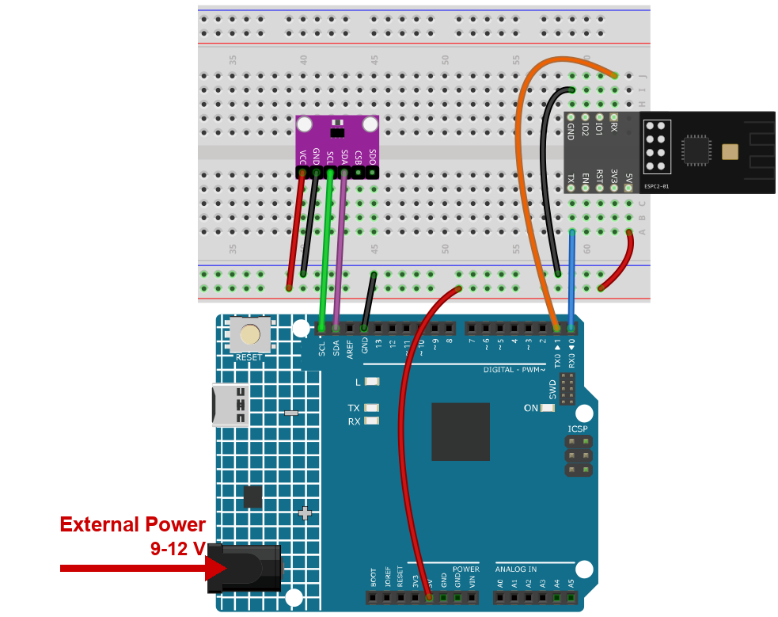
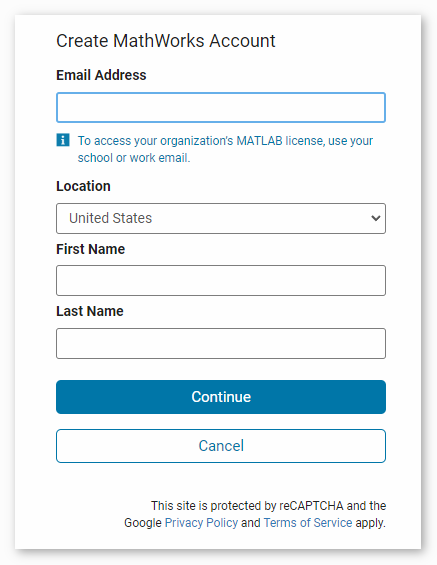
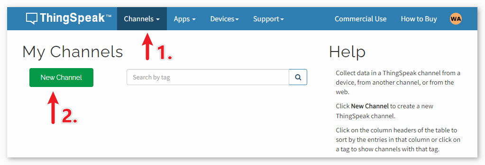
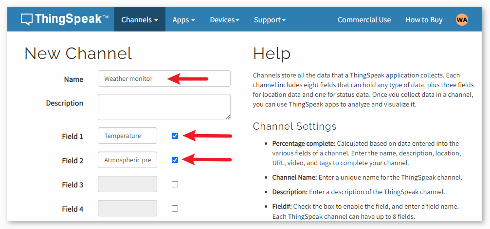

.. note::

    Hallo und willkommen in der SunFounder Raspberry Pi & Arduino & ESP32 Enthusiasten-Gemeinschaft auf Facebook! Tauchen Sie tiefer ein in die Welt von Raspberry Pi, Arduino und ESP32 mit anderen Enthusiasten.

    **Warum beitreten?**

    - **Expertenunterstützung**: Lösen Sie Nachverkaufsprobleme und technische Herausforderungen mit Hilfe unserer Gemeinschaft und unseres Teams.
    - **Lernen & Teilen**: Tauschen Sie Tipps und Anleitungen aus, um Ihre Fähigkeiten zu verbessern.
    - **Exklusive Vorschauen**: Erhalten Sie frühzeitigen Zugang zu neuen Produktankündigungen und exklusiven Einblicken.
    - **Spezialrabatte**: Genießen Sie exklusive Rabatte auf unsere neuesten Produkte.
    - **Festliche Aktionen und Gewinnspiele**: Nehmen Sie an Gewinnspielen und Feiertagsaktionen teil.

    👉 Sind Sie bereit, mit uns zu erkunden und zu erschaffen? Klicken Sie auf [|link_sf_facebook|] und treten Sie heute bei!

.. _c201_iot_Weather_monitor:

5. Wettermonitor mit ThingSpeak
====================================

.. raw:: html

   <video loop autoplay muted style = "max-width:100%">
      <source src="../../_static/video/iot/05-iot_Weather_monitor.mp4"  type="video/mp4">
      Ihr Browser unterstützt das Video-Tag nicht.
   </video>

Dieses Projekt erfasst Temperatur und Luftdruck mit einem Drucksensor und überträgt die
Werte in regelmäßigen Abständen über das ESPC2-01-Modul und das WLAN an die
ThingSpeak-Cloud.

1. Schaltung aufbauen
-----------------------------

.. note::

    Das Modul zieht beim Start einen hohen Strom. Stecken Sie deshalb die 9-V-Batterie
    bzw. das externe Netzteil in die Hohlbuchse des R4 Minima.

* :ref:`cpn_uno`
* :ref:`cpn_espc201`
* :ref:`cpn_bmp280`

2. ThingSpeak einrichten
-----------------------------

|link_thingspeak| ™ ist eine IoT-Analyseplattform, mit der Sie Live-Datenströme in der
Cloud sammeln, visualisieren und auswerten. ThingSpeak zeigt die Daten Ihrer Geräte sofort
als Diagramm. Weil darin MATLAB®-Code läuft, können Sie die eintreffenden Daten auch
online analysieren. ThingSpeak wird oft für Prototypen und Machbarkeitsstudien genutzt,
die Auswertung brauchen.

.. image:: https://thingspeak.com/assets/Signup_TSP_ML_image-3d581d644f5eb1ff9f4999fc55ad04e2530ee7f54be98323d7bb453032353750.svg
   :width: 80%

.. raw:: html
    
       

**2.1 ThingSpeak-Konto anlegen**
^^^^^^^^^^^^^^^^^^^^^^^^^^^^^^^^^^^^^^^^

Zuerst brauchen Sie ein ThingSpeak-Konto. Seit der Zusammenarbeit mit MATLAB können Sie
Ihre MathWorks-Zugangsdaten für die Anmeldung bei |link_thingspeak| verwenden.

Wenn Sie keine haben, legen Sie ein Konto bei MathWorks an und melden sich dann bei
ThingSpeak an.

**2.2 Kanal anlegen**
^^^^^^^^^^^^^^^^^^^^^^^^^^^^^^^^^^^^^^^^

Nach der Anmeldung legen Sie einen neuen Kanal an: **Channels** > **My Channels** >
**New Channel**.

Für dieses Projekt heißt der Kanal "**Weather Monitor**" und hat zwei Felder: **Field 1**
für "**Temperature**" und **Field 2** für "**Atmospheric Pressure**".

.. raw:: html
    
       

3. Code ausführen
-----------------------------

#. Öffnen Sie die Datei ``05-Weather_monitor.ino`` unter dem Pfad ``ultimate-sensor-kit\code\iot_project_espc201\wifi\05-Weather_monitor`` oder kopieren Sie den Code in die **Arduino IDE**.

   .. note::

      Der Sketch braucht die Bibliothek **Adafruit BMP280**. Öffnen Sie den
      Bibliotheksverwalter, suchen Sie ``Adafruit BMP280`` und installieren Sie sie.

#. Tragen Sie Namen und Passwort Ihres WLAN-Netzes ein.

   .. code-block:: arduino

      String mySSID = "your_ssid";
      String myPWD  = "your_password";

#. Fügen Sie den **Write API Key** Ihres ThingSpeak-Kanals in ``myAPI`` ein.

   .. code-block:: arduino

      String myAPI = "xxxxxxxxxxxxxxx";

   .. image:: ../img/new/05-thingspeak_api_shadow.png
      :width: 80%

   .. note::

      Nehmen Sie den **Write**-Key des Kanals, nicht den Read-Key und nicht den
      User-Key. Halten Sie ihn geheim: Wer ihn hat, kann Daten in Ihren Kanal schreiben.

#. Wählen Sie **Arduino UNO R4 Minima** und den richtigen Port und klicken Sie auf
   **Upload**.

#. Öffnen Sie den Seriellen Monitor mit **115200**. Nach wenigen Sekunden sollten Sie
   lesen:

   .. code-block:: text

      === Weather Monitor (ThingSpeak) ===
      module is ready
      joining Wi-Fi ... connected
      BMP280 is ready

   und danach alle 20 Sekunden:

   .. code-block:: text

      > AT+CIPSTART="TCP","api.thingspeak.com",80
      > AT+CIPSEND=96
      update sent to ThingSpeak
      Temperature: 27.31 C.  Pressure: 100842.00 Pa

   .. note::

      Steht dort ``Could not find a BMP280, check the wiring and the address``, lassen Sie
      einen I2C-Scanner laufen oder probieren Sie einfach die andere Adresse: Manche Module
      antworten auf ``0x77`` statt ``0x76``. Der Sketch testet bereits beide, die Meldung
      heißt also, dass keine geantwortet hat - prüfen Sie SDA, SCL, VCC und GND.

   .. image:: ../img/new/05-ready_1_shadow.png
      :width: 80%

   .. image:: ../img/new/05-ready_2_shadow.png
      :width: 80%

#. Öffnen Sie Ihren ThingSpeak-Kanal. Alle 20 Sekunden erscheint ein neuer Punkt im
   Diagramm.

   .. note::

      Ein kostenloser ThingSpeak-Kanal nimmt eine Aktualisierung alle 15 Sekunden an. Der
      Sketch wartet 20 Sekunden, Sie verlieren also keinen Punkt.

4. Code-Erklärung
-----------------------------

Dieses Projekt nutzt kein Blynk. Die Platine spricht über die AT-Befehle einfaches HTTP
mit ThingSpeak, genau wie ein Browser eine Webseite anfordert - deshalb können Sie die
Werte anschließend in jedem Browser ansehen.

#. **Was Sie eintragen müssen**

   .. code-block:: arduino

      String mySSID = "your_ssid";
      String myPWD  = "your_password";
      String myAPI  = "xxxxxxxxxxxxxxx";
      String myHOST = "api.thingspeak.com";
      String myPORT = "80";

   Host und Port ändern sich nie. Nur der API-Key ist persönlich - er sagt ThingSpeak,
   zu welchem Kanal die Zahlen gehören.

#. **Die serielle Schnittstelle zum Modul**

   Das ESPC2-01 arbeitet als Modem: Der Sketch sendet ihm AT-Befehle auf D0/D1, also über
   ``Serial1``, eine Hardware-Schnittstelle; 115200 funktioniert ohne Bitfehler.

   .. code-block:: arduino

      #define EspSerial Serial1

   ``espModuleInit()`` wartet, bis das Modul fertig gestartet ist, und schaltet dann mit
   ``ATE0`` das Echo ab. Ohne sie mischen sich Startprotokoll und zurückgespiegelte
   Befehle in die Antworten.

#. **at() - ein AT-Befehl mit Zeitlimit**

   .. code-block:: arduino

      String at(const String& cmd, unsigned long waitMs, const char* okMark, const char* errMark) {
        while (EspSerial.available()) EspSerial.read();
        EspSerial.print(cmd);
        EspSerial.print("\r\n");

        unsigned long t0 = millis();
        String r;
        while (millis() - t0 < waitMs) {
          while (EspSerial.available() && r.length() < 512) r += (char)EspSerial.read();
          if (okMark && r.indexOf(okMark) >= 0) break;
          if (errMark && r.indexOf(errMark) >= 0) break;
        }
        return r;
      }

   Jeder Befehl läuft durch diese eine Funktion. Sie hört auf, sobald die erwartete
   Antwort da ist, und **kehrt immer zurück** - ein fehlendes ``OK`` kann die Platine nie
   einfrieren.

#. **joinWiFi()**

   .. code-block:: arduino

      at("AT+CWMODE=1", 1500, "OK", "ERROR");
      String r = at("AT+CWJAP=\"" + mySSID + "\",\"" + myPWD + "\"", 20000,
                   "WIFI GOT IP", "FAIL");

   ``AT+CWJAP`` braucht mehrere Sekunden - das Modul muss den Zugangspunkt finden, die
   Schlüssel austauschen und eine IP-Adresse bekommen. Deshalb bekommt es 20 Sekunden,
   während die anderen Befehle mit einer auskommen.

#. **Der BMP280**

   .. code-block:: arduino

      if (!bmp.begin(BMP280_ADDRESS)) {
        if (!bmp.begin(0x77)) {
          ...   // aufgeben, es gibt nichts zu messen
        }
      }

   Der Chip antwortet auf ``0x76`` oder ``0x77``, je nachdem, wie sein SDO-Pin
   beschaltet ist. Der Sketch probiert beide, bevor er aufgibt.

#. **loop() - ein Timer ohne delay()**

   .. code-block:: arduino

      if (millis() - lastConnectionTime > postingInterval) {
        sendData();
      }

   ``millis()`` zählt die Millisekunden seit dem Einschalten. Der Vergleich mit der
   letzten Aktualisierung ist eine Verzögerung, die das Programm **nicht** anhält - die
   Platine bleibt frei für alles andere. Ein kostenloser ThingSpeak-Kanal nimmt eine
   Aktualisierung alle 15 Sekunden an, 20 Sekunden sind also ein sicheres Intervall.

#. **sendData() - Anfrage bauen und abschicken**

   .. code-block:: arduino

      String req = "GET /update?api_key=" + myAPI;
      req += "&field1=" + String(temperature);
      req += "&field2=" + String(pressure);
      req += " HTTP/1.1\r\nHost: api.thingspeak.com\r\nConnection: close\r\n\r\n";

      at("AT+CIPMUX=0", 1000, "OK", "ERROR");
      at("AT+CIPSTART=\"TCP\",\"" + myHOST + "\"," + myPORT, 5000, "OK", "ERROR");

      EspSerial.print("AT+CIPSEND=");
      EspSerial.print(req.length());
      ...
      EspSerial.print(req);

   Drei AT-Befehle erledigen die Arbeit:

   * ``AT+CIPMUX=0`` - eine Verbindung zur Zeit.
   * ``AT+CIPSTART`` - eine TCP-Verbindung zu ``api.thingspeak.com:80`` öffnen.
   * ``AT+CIPSEND=<Länge>`` - das Modul antwortet mit ``>``, und erst dann senden Sie die
     Anfrage. Die Länge muss der **genauen** Zeichenzahl von ``req`` entsprechen, deshalb
     misst der Sketch ``req.length()`` statt zu raten.

   ``field1`` und ``field2`` sind die beiden Spalten Ihres Kanals. Wie Sie sie in
   ThingSpeak nennen, ist egal - die Zahlen landen in dieser Reihenfolge dort.
