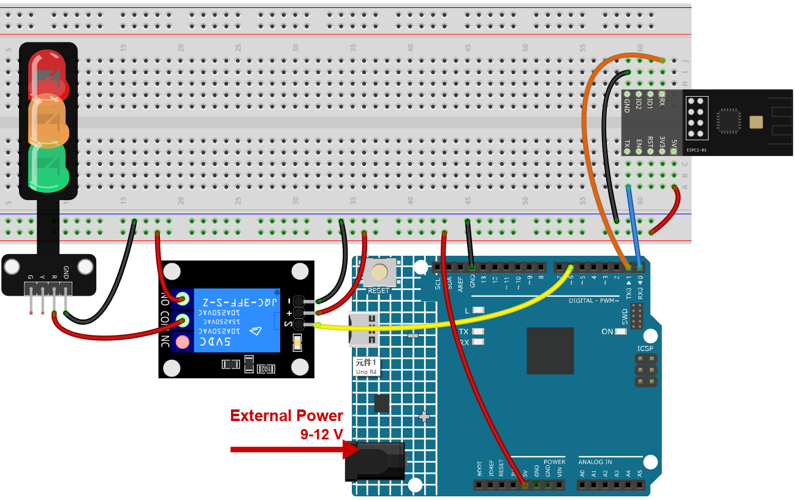

.. note::

    こんにちは、SunFounderのRaspberry Pi & Arduino & ESP32愛好家コミュニティへようこそ！Facebook上でRaspberry Pi、Arduino、ESP32についてもっと深く掘り下げ、他の愛好家と交流しましょう。

    **参加する理由は？**

    - **エキスパートサポート**：コミュニティやチームの助けを借りて、販売後の問題や技術的な課題を解決します。
    - **学び＆共有**：ヒントやチュートリアルを交換してスキルを向上させましょう。
    - **独占的なプレビュー**：新製品の発表や先行プレビューに早期アクセスしましょう。
    - **特別割引**：最新製品の独占割引をお楽しみください。
    - **祭りのプロモーションとギフト**：ギフトや祝日のプロモーションに参加しましょう。

    👉 私たちと一緒に探索し、創造する準備はできていますか？[|link_sf_facebook|]をクリックして今すぐ参加しましょう！

.. _c201_iot_Remote_relay_controller:

6. Blynk を使った遠隔リレー制御
===============================================

.. raw:: html

   <video loop autoplay muted style = "max-width:100%">
      <source src="../../_static/video/iot/06-iot_Remote_relay_controller.mp4"  type="video/mp4">
      お使いのブラウザは video タグに対応していません。
   </video>

このプロジェクトは、Blynk アプリの仮想スイッチで操作できる遠隔リレー制御を作りま
す。スイッチを ON にするとリレーのデジタルピンが HIGH、OFF にすると LOW になります。
これで離れた場所からリレーを簡単に操作でき、実質的に遠隔スイッチになります。

1. 回路を組み立てる
-----------------------------

.. warning ::

    次の例では、リレーで LED モジュールを制御します。**実際の用途ではリレーを他の
    機器につなぐこともできますが、高電圧の交流を扱うには細心の注意が必要です。誤った
    使い方は重傷や死亡につながります。したがって、高電圧の交流に精通した人を対象とし
    た例です。安全を最優先にしてください。**

.. note::

   モジュールは起動時に大きな電流を引きます。9V 電池または外部電源を R4 Minima
   の DC ジャックに必ず接続してください。

* :ref:`cpn_uno`
* :ref:`cpn_espc201`
* :ref:`cpn_relay`
* :ref:`cpn_traffic`

2. Blynk を設定する
-----------------------------

.. note::

    テンプレートとデバイスは :ref:`c201_iot_blynk_start` で一度作成済みです。どのプ
    ロジェクトも **同じ** テンプレートにデータストリームを追加するので、プロジェクト
    ごとに仮想ピンの範囲が分かれます。このプロジェクトは **V7** を使います。

**このプロジェクトがクラウドに送るもの**

整数 1 つ、``relay_status`` です。センサーの値ではなく、リレーの状態を映す値です。
だからアプリとボードは、リレーが ON かどうかで常に一致します。

**データストリームを追加する**

#. **Developer Zone** -> **My Templates** を開き、**Ultimate Sensor Kit** をクリック
   します。

   .. image:: ../img/blynk_template.png
      :width: 80%

#. **Edit** をクリックしてテンプレートを開きます。

   .. image:: ../img/blynk_edit.png
      :width: 80%

#. **Datastreams** をクリックし、**Create New** を選びます。

   .. image:: ../img/blynk_new_data.png
      :width: 80%

#. フォームを次のように入力します。

   * **DATASTREAM NAME**: ``relay_status``
   * **DISPLAY NAME**: ``Relay Status``
   * **VIRTUAL PIN**: ``V7``
   * **DATA TYPE**: **Integer**
   * **MIN** ``0``, **MAX** ``1``

   .. image:: ../img/blynk_relay_data.png
      :width: 80%

**Web ダッシュボードを追加する**

#. **Dashboard** をクリックし、**Add Widget** を選びます。

   .. image:: ../img/blynk_dashboard.png
      :width: 80%

#. **Switch** ウィジェットをダッシュボードにドラッグします。

   .. image:: ../img/blynk_dashboard_switch.png
      :width: 80%

#. **Switch** の右上の三点メニューから **Settings** を選びます。

   * **Datastream** を ``Relay Status (V7)`` に設定します。

   .. note::

      **Switch** は値を表示し、同時に設定もします。タップすると ``1`` か ``0`` が
      ボードに送られ、ボードはリレーを切り替えて同じ値を書き戻すので、素早く 2 回
      タップしてもスイッチの表示がずれません。

   .. image:: ../img/blynk_relay_widget.png
      :width: 80%

#. **Save** をクリックします。

   .. image:: ../img/blynk_save.png
      :width: 40%

3. コードを実行する
-----------------------------

#. ``06-Remote_relay_controller.ino`` を ``ultimate-sensor-kit\code\iot_project_espc201\wifi\06-Remote_relay_controller`` から開くか、コードを **Arduino IDE** にコピーします。

#. Blynk の 3 行は入門章でコピー済みです。このキットのどのプロジェクトも同じデバイ
   スを使うので、変更は不要です - プロジェクト固有なのは下の Wi-Fi 設定だけです。

   .. code-block:: arduino

      #define BLYNK_TEMPLATE_ID   "TMPLxxxxxx"
      #define BLYNK_TEMPLATE_NAME "Ultimate Sensor Kit"
      #define BLYNK_AUTH_TOKEN    "YourAuthToken"

#. 自分の Wi-Fi ネットワークの名前とパスワードを入力します。

   .. code-block:: arduino

      char ssid[] = "your_ssid";
      char pass[] = "your_password";

#. **Arduino UNO R4 Minima** と正しいポートを選び、**Upload** をクリックします。

#. シリアルモニターを **115200** で開きます。ボードがクラウドに到達するとログの最後
   が ``Ready`` になり、アプリでスイッチを動かすたびにここに 1 行出ます。

   .. code-block:: text

      [28358] Ready (ping: 285ms).
      The switch on Blynk has been turned on.
      The switch on Blynk has been turned off.

   このエコーが、アプリとボードが本当に通信しているかを確かめる最短の方法です。

   .. image:: ../img/blynk_relay_serial.png
      :width: 80%

#. スイッチをタップするとリレーがカチッと鳴ります。もう一度タップすると戻ります。

   .. note::

      リレーは停電後も位置を保ちます。ボードは再接続時にサーバーへ最後の値を問い合わ
      せ（``Blynk.syncVirtual(V7)``）、常に OFF から始まるのではなく、あなたが離れたと
      きの状態に戻ります。

   .. image:: ../img/blynk_relay_dashbaord.png
      :width: 80%

4. コードの説明
-----------------------------

#. **Blynk アカウントとライブラリ**

   最初の 3 行は、このボードがどの Blynk デバイスに属するかを示します。デバイス
   ページの内容で、このキットのどのプロジェクトでも同じです。

   .. code-block:: arduino

      #define BLYNK_TEMPLATE_ID   "TMPL2Ms3WVki8"
      #define BLYNK_TEMPLATE_NAME "Ultimate Sensor Kit"
      #define BLYNK_AUTH_TOKEN    "lHSd4Q5pXP7YKUovVfPZYZqC0UHVORY6"

      #define BLYNK_PRINT Serial   // Blynk のログをシリアルモニターに出す

      #include <ESP8266_Lib.h>               // AT コマンドを送る
      #include <BlynkSimpleShieldEsp8266.h>  // その上で動く Blynk

#. **モジュールと通信するシリアルポート**

   ESPC2-01 はモデムとして動作し、スケッチが AT コマンドを送ります。R4 では D0/D1、
   つまり ``Serial1`` につながっており、ハードウェアポートなので 115200 でもビット化
   けしません。

   .. code-block:: arduino

      #define EspSerial Serial1
      #define ESP8266_BAUD 115200
      ESP8266 wifi(&EspSerial);

   ``espModuleInit()`` はモジュールの起動完了を待ってから ``ATE0`` でエコーを切りま
   す。これがないと起動ログとエコーされたコマンドが応答に混ざり、Blynk が読めません。

#. **リレーのピン**

   .. code-block:: arduino

      const int RelayPin = 6;
      int switchStatus = 0;

   ``RelayPin`` はリレーモジュールを駆動するピンで、ここでは D6 です。``switchStatus``
   はアプリが送ってきた最後の値を保持するだけで、コードの 1 か所で「ON」と「OFF」を区
   別できます。

   .. note::

      リレーモジュールには逆向きに動作するものもあり、ピンが **LOW** のときに閉じま
      す。アプリのスイッチと逆にカチッと鳴る場合は、下の関数で ``HIGH`` と ``LOW`` を
      入れ替えてください。他は何も変わりません。

#. **setup()**

   .. code-block:: arduino

      void setup() {
        pinMode(RelayPin, OUTPUT);
        digitalWrite(RelayPin, LOW);

        Serial.begin(115200);
        EspSerial.begin(ESP8266_BAUD);
        delay(10);

        espModuleInit();
        Blynk.config(wifi, BLYNK_AUTH_TOKEN);
        Blynk.connectWiFi(ssid, pass);
      }

   ``pinMode`` の直後の ``digitalWrite(RelayPin, LOW)`` が重要です。出力になったば
   かりのピンは一瞬 HIGH になることがあり、電源投入のたびにリレーがカチッと鳴ってし
   まいます。

#. **loop()**

   .. code-block:: arduino

      void loop() {
        Blynk.run();
        timer.run();
      }

   ``Blynk.run()`` が接続を保ちます。このプロジェクトには測るものが無いので、ループ
   は他の仕事をしません - それでも可能な限り速く回す必要があります。

#. **BLYNK_CONNECTED() - 最後の状態を復元する**

   .. code-block:: arduino

      BLYNK_CONNECTED() {
        Blynk.syncVirtual(V7);
      }

   これはボードがサーバーに到達するたびに実行されます。停電の後もです。
   ``Blynk.syncVirtual(V7)`` が保存されたスイッチの値を問い合わせ、サーバーは
   ``BLYNK_WRITE(V7)`` を呼び出して答えるので、リレーはあなたが離れたときの状態にな
   ります。

#. **BLYNK_WRITE(V7) - スイッチが仕事をする**

   .. code-block:: arduino

      BLYNK_WRITE(V7) {
        switchStatus = param.asInt();

        if (switchStatus == 1) {
          Serial.println("The switch on Blynk has been turned on.");
          digitalWrite(RelayPin, HIGH);
        } else {
          Serial.println("The switch on Blynk has been turned off.");
          digitalWrite(RelayPin, LOW);
        }
      }

   * ``BLYNK_WRITE(V7)`` はデータストリーム **V7** が変わるたびに自動で実行されま
     す。``loop()`` から呼び出すことはありません。
   * ``param.asInt()`` が新しい値で、スイッチ ON なら ``1``、OFF なら ``0`` です。
   * ``Serial.println`` の行はあなたのためのもので、シリアルモニターでスイッチを追え
     ます。
