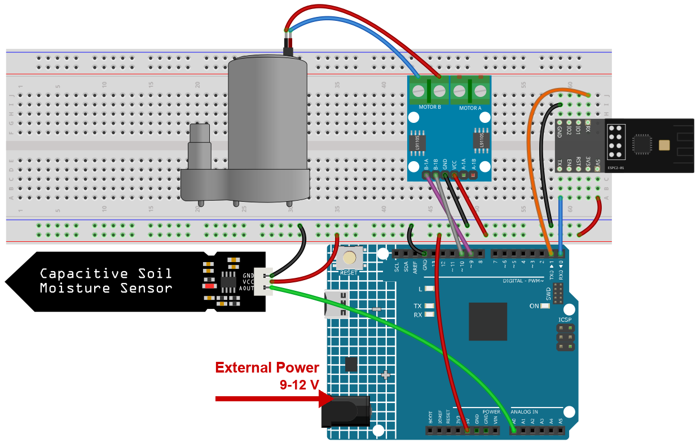

.. note::

    Hello, welcome to the SunFounder Raspberry Pi & Arduino & ESP32 Enthusiasts Community on Facebook! Dive deeper into Raspberry Pi, Arduino, and ESP32 with fellow enthusiasts.

    **Why Join?**

    - **Expert Support**: Solve post-sale issues and technical challenges with help from our community and team.
    - **Learn & Share**: Exchange tips and tutorials to enhance your skills.
    - **Exclusive Previews**: Get early access to new product announcements and sneak peeks.
    - **Special Discounts**: Enjoy exclusive discounts on our newest products.
    - **Festive Promotions and Giveaways**: Take part in giveaways and holiday promotions.

    👉 Ready to explore and create with us? Click [|link_sf_facebook|] and join today!

.. _c201_iot_Auto_watering_system:

7. Auto Watering System with Blynk
===================================

.. raw:: html

   <video loop autoplay muted style = "max-width:100%">
      <source src="../../_static/video/iot/07-iot_Auto_watering_system.mp4"  type="video/mp4">
      Your browser does not support the video tag.
   </video>

A soil moisture probe goes into the pot and a small pump sits in a glass of water.
The board reports how wet the soil is, and - once you allow it - switches the pump on
by itself before the plant gets thirsty.

From the phone you can watch the moisture, drag a slider to choose how dry the soil may
get, and decide whether the kit is allowed to water on its own.

1. Build the Circuit
-----------------------------

.. note::

    The module draws a high current at start-up, so make sure the 9 V battery or an external power supply is plugged into the DC jack of the R4 Minima.

* :ref:`cpn_uno`
* :ref:`cpn_espc201`
* :ref:`cpn_soil`
* :ref:`cpn_pump`

2. Configure Blynk
-----------------------------

.. note::

    The template and the device were created once in :ref:`c201_iot_blynk_start`.
    Every project adds its datastreams to that **same** template, so each project
    occupies its own range of virtual pins. This project uses **V8** to **V10**.

**What this project sends to the cloud**

Three values, and they do different jobs:

* ``moisture_percentage`` - the board writes this, so you can see how wet the soil is.
* ``water_threshold`` - you write this from the slider: the level below which the pump runs.
* ``auto_mode`` - a switch that decides whether the board is allowed to start the pump by itself.

**Add the datastreams**

#. Open **Developer Zone** -> **My Templates**, click **Ultimate Sensor Kit**.

   .. image:: ../img/blynk_template.png
      :width: 80%

#. Click **Edit** to open the template.

   .. image:: ../img/blynk_edit.png
      :width: 80%
      
#. Click **Datastreams**, then **Create New**.

   .. image:: ../img/blynk_new_data.png
      :width: 80%

#. Create the first datastream - a **Virtual Pin** datastream. Nothing is wired to ``V8``:
   a virtual pin only exists in the cloud, it is a mailbox the board and the app share.

   * **DATASTREAM NAME**: ``moisture_percentage``
   * **DISPLAY NAME**: ``Moisture Percentage``
   * **VIRTUAL PIN**: ``V8``
   * **DATA TYPE**: **Double**
   * **MIN** ``0``, **MAX** ``100``

   .. image:: ../img/blynk_water_data_mois.png
      :width: 80%

#. Set the **UNITS** field to ``Percentage``.

   .. image:: ../img/blynk_water_data_unit.png
      :width: 80%

#. Create the other **two** Virtual Pin datastreams the same way - click **Create New**
   twice more:

   .. list-table::
      :header-rows: 1
      :widths: 10 26 24 14 16 10

      * - Pin
        - Datastream name
        - Display name
        - Type
        - Min / Max
        - Units
      * - V9
        - ``water_threshold``
        - ``Water Threshold``
        - **Double**
        - 0 / 100
        - Percent
      * - V10
        - ``auto_mode``
        - ``Auto Mode``
        - **Integer**
        - 0 / 1
        - None

   .. image:: ../img/blynk_water_datastreams.png
      :width: 80%

**Add the web dashboard**

#. Click **Dashboard**, then **Add Widget**.

   .. image:: ../img/blynk_dashboard.png
      :width: 80%

#. Drag a **Gauge** widget onto the dashboard.

   .. image:: ../img/blynk_dashboard_gauge.png
      :width: 80%

#. Click the three dots in the corner of the **Gauge** and choose **Settings**. 

   * Set **Datastream** to ``Moisture Percentage (V8)``.

   .. image:: ../img/blynk_water_gauge_set.png
      :width: 80%  

#. Drag a **Slider** and a **Switch** onto the dashboard the same way, then bind them:

   .. list-table::
      :header-rows: 1
      :widths: 26 40 34

      * - Widget
        - Datastream
        - What it is for
      * - Slider
        - ``Water Threshold (V9)``
        - set the level at which watering starts
      * - Switch
        - ``Auto Mode (V10)``
        - allow the board to drive the pump on its own

   
   .. image:: ../img/blynk_water_widgets.png
      :width: 80%

   .. note::

      With **auto_mode** off the pump never runs, whatever the slider says. That is the
      safe default: you can watch the readings for a while before letting the kit water
      the plant on its own.

#. Click **Save**.

   .. image:: ../img/blynk_save.png
      :width: 40%

3. Run the Code
-----------------------------

#. Open the ``07-Auto_watering_system.ino`` file under the path of ``ultimate-sensor-kit\code\iot_project_espc201\wifi\07-Auto_watering_system``, or copy this code into **Arduino IDE**.

#. The three Blynk lines were copied in the Get Started chapter - leave them as they are.

   .. code-block:: arduino

      #define BLYNK_TEMPLATE_ID   "TMPLxxxxxx"
      #define BLYNK_TEMPLATE_NAME "Ultimate Sensor Kit"
      #define BLYNK_AUTH_TOKEN    "YourAuthToken"

#. Type the name and the password of your own Wi-Fi network.

   .. code-block:: arduino

      char ssid[] = "your_ssid";
      char pass[] = "your_password";

#. Select **Arduino UNO R4 Minima** and the right port, then click **Upload**.

#. Open the Serial Monitor at **115200**. Every 10 seconds the board reports the soil:

   .. code-block:: text

      -----------------------------
      Update soil moisture data ...
      sensorValue:453  moisturePercentage:32.16

   The number after ``sensorValue`` is the **raw** reading of the probe. Ignore the
   percentage for now - it is not calibrated yet.

#. Calibrate the probe, because every probe and every soil is different:

   #. Hold the probe **in the air** (dry) and write down the ``sensorValue``, for example
      ``535``.
   #. Put the probe **in a glass of water** and write down the second ``sensorValue``, for
      example ``280``.
   #. Put both numbers into the sketch:

      .. code-block:: arduino

         const float moistureInAir = 535;     // reading in dry air
         const float moistureInWater = 280;   // reading in water

   #. Upload again. Now the percentage really means something: 0 % is as dry as the air,
      100 % is as wet as the water.

   .. note::

      The probe reads **higher when dry and lower when wet** - that is why the two
      numbers appear in this order in the formula. If you skip the calibration the
      percentage is still shown, but the gauge may sit at 0 % in damp soil or at 100 % in
      dry soil.

   .. image:: ../img/blynk_water_serial.png
      :width: 80%

#. On the dashboard, drag the **slider** to a value above the current moisture (for
   example 40) and turn **Auto Mode** on. Within 35 seconds the pump starts, and the
   gauge begins to climb.

   .. note::

      The pump only ever runs when **Auto Mode** is on. With the switch off you can watch
      the readings for as long as you like and the pump stays quiet.

   .. image:: ../img/blynk_water_dashboard.png
      :width: 80%

4. Code explanation
-----------------------------

#. **Blynk account and libraries**

   The first three lines say which Blynk device this board belongs to. They come from the
   device page and are identical in every project of this kit.

   .. code-block:: arduino

      #define BLYNK_TEMPLATE_ID   "TMPL2Ms3WVki8"
      #define BLYNK_TEMPLATE_NAME "Ultimate Sensor Kit"
      #define BLYNK_AUTH_TOKEN    "lHSd4Q5pXP7YKUovVfPZYZqC0UHVORY6"

      #define BLYNK_PRINT Serial   // show Blynk's own log on the Serial Monitor

#. **The serial port that talks to the module**

   The ESPC2-01 works as a modem: the sketch sends it AT commands on D0/D1, which is
   ``Serial1``, a hardware port. ``espModuleInit()`` waits for the module to boot and then
   sends ``ATE0`` so the replies stop carrying a copy of the command.

   .. code-block:: arduino

      #define EspSerial Serial1
      #define ESP8266_BAUD 115200
      ESP8266 wifi(&EspSerial);

#. **The pump**

   .. code-block:: arduino

      const int pump1A = 9;
      const int pump1B = 10;
      bool pumpStatus = 0;

   The pump runs through an **L9110** driver. Give ``1A`` a HIGH level and the pump turns;
   ``1B`` stays LOW, it is only needed to reverse a motor. A relay or a simple transistor
   would work the same way - one pin, on or off.

#. **The probe and its two calibration points**

   .. code-block:: arduino

      const float moistureInAir = 535;
      const float moistureInWater = 280;
      const int sensorPin = A0;

   The probe returns a raw number, and - this is the surprising part - **the wetter the
   soil, the lower the number**. The sketch turns that into a percentage:

   .. code-block:: arduino

      moisturePercentage = 1 - (sensorValue - moistureInWater) / (moistureInAir - moistureInWater);

   With the two calibration values this maps "in water" to ``1.0`` and "in air" to
   ``0.0``, and everything in between proportionally.

#. **Two timers, two different jobs**

   .. code-block:: arduino

      timer.setInterval(10000L, updateDataTimer);   // report every 10 s
      timer.setInterval(35000L, autoWaterTimer);    // check the pump every 35 s

   Measuring is cheap, so it happens often. Starting a pump is not, so it is checked more
   slowly - and ``delay()`` is never used, so the Blynk connection keeps running.

#. **BLYNK_CONNECTED() and the two writes**

   .. code-block:: arduino

      BLYNK_CONNECTED() {
        Blynk.syncVirtual(V9);
        Blynk.syncVirtual(V10);
      }

      BLYNK_WRITE(V9)  { waterThreshold = param.asInt(); }
      BLYNK_WRITE(V10) { autoMode       = param.asInt(); }

   ``BLYNK_CONNECTED()`` runs at every connection, including after a power cut, and asks
   the server for the slider and the switch. Without it a restarted board would water with
   a threshold of ``0`` - that is, never.

#. **sendData() - report, autoWater() - act**

   .. code-block:: arduino

      void sendData() {
        sensorValue = analogRead(sensorPin);
        moisturePercentage = 1 - (sensorValue - moistureInWater) / (moistureInAir - moistureInWater);
        Blynk.virtualWrite(V8, moisturePercentage * 100);
      }

      void autoWater() {
        if (autoMode == 1 && moisturePercentage * 100 < waterThreshold) {
          // run the pump for a while
        }
      }

   ``sendData()`` only reads and reports - it never touches the pump. ``autoWater()`` is the
   only place that starts it, and it needs **both** conditions: the automatic mode on, and
   the soil drier than your slider.
